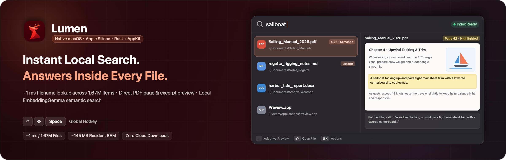

<p align="center">
  
</p>

<p align="center">
  
</p>

<h1 align="center">Lumen</h1>

<p align="center">
  <strong>Find files, launch apps, jump to System Settings, and preview exact answers inside documents from one shortcut.</strong><br>
  Powered by a compact zero-posting SoA + AArch64 NEON Rust engine and a native AppKit / SwiftUI interface.<br>
  Combines millisecond disk-wide filename &amp; pinyin search, matched-page PDF highlighting, offline EmbeddingGemma retrieval, and strict zero-download cloud boundaries.
</p>

<p align="center">
  <a href="#interface-gallery">Interface</a> ·
  <a href="#why-lumen">Why Lumen</a> ·
  <a href="#comparison-with-alternatives">Comparison</a> ·
  <a href="#verified-benchmarks">Benchmarks</a> ·
  <a href="#quick-start--installation">Quick Start</a> ·
  <a href="README.md">简体中文</a>
</p>

<p align="center">
  <code>v0.5.1</code> · <code>Apple Silicon</code> · <code>macOS 14+</code> · <code>Rust + AppKit / SwiftUI</code> · <a href="LICENSE"><code>MIT License</code></a>
</p>

---

| Try typing | What happens |
| :--- | :--- |
| `Q4 plan pdf` | Matches multiple keywords and filters by real PDF extension; quote for exact phrases |
| `luming` / `lm` | Finds files named 鹿鸣 via full pinyin or initials |
| `Bluetooth` / `25 km in mi` | Jump straight to System Settings or convert units locally—no file index required |
| `tr:zh Meeting postponed` | Streams translation inside the launcher (`Return` copies output; supports local oMLX or OpenAI-compatible endpoints) |
| `qa How to structure a review?` | Sends only your explicit prompt to the selected model; `Esc` cancels cleanly with no web or file leakage |
| `img sailboat` | Searches indexed local photos semantically using on-device vision embeddings |

---

## Interface Gallery

### Search & Visual-First Matched-Page Preview (Light & Dark)

> Press **`Space`** (while browsing) or **`⌘Y`** on a PDF hit: inline preview puts the rendered matched page with translucent amber passage highlights **above** the extracted text context, while the standalone Quick Look window scales automatically to match the true aspect ratio and rotation of PDFs, images, docs, or media.

<p align="center">
  <picture>
    <source media="(prefers-color-scheme: dark)" srcset="assets/readme/search-dark.png">
    <source media="(prefers-color-scheme: light)" srcset="assets/readme/search-light.png">
    
  </picture>
</p>

### Native macOS Settings & Tactile Shortcuts

> Native `.switch` toggles, keycap shortcut capture, isolated include/exclude indexing rules, and offline diagnostics without waking cloud placeholders.

<p align="center">
  <picture>
    <source media="(prefers-color-scheme: dark)" srcset="assets/readme/settings-dark.png">
    <source media="(prefers-color-scheme: light)" srcset="assets/readme/settings-light.png">
    
  </picture>
</p>

---

## Why Lumen

- **~1 ms Disk-Wide Filename Search in ~145 MiB Resident RAM**
  Instead of duplicating large inverted posting tables across search lanes, Lumen runs one compact structure-of-arrays (SoA) table scanned in parallel with **AArch64 NEON SIMD**. On a real Apple Silicon index of **1,667,692 disk items**, warm name, pinyin, and path queries finish in **0.79–1.75 ms** inside a **144.7 MiB** resident worker.
- **Visual-First Document Preview That Jumps to the Matched Page**
  Lumen extracts local TXT, Markdown, DOCX paragraphs/tables, and native PDF text layers on demand. For PDF hits, both inline preview and the Quick Look window jump directly to the matched page (`Match on page N`) and highlight matching terms in translucent amber—keeping visuals first without stealing search focus.
- **Content-Proportional Quick Look Windows**
  `LocalPreviewPanel` adapts its geometry to the inspected item: PDF CropBox & page rotation, image pixel dimensions & EXIF orientation, wide spreadsheets/decks, upright documents/code, video, or audio—instead of forcing every file into a rigid box.
- **Calibrated Local EmbeddingGemma Semantic & Image Search**
  With optional locally staged weights, EmbeddingGemma finds related documents cleanly while strict relevance calibration suppresses unrelated noise to **0 false hits**. Local visual search (`img ...`) covers PNG and JPEG (plus HEIC/WebP and opt-in on-device Apple Vision OCR pipelines). Name search needs zero AI models.
- **Cloud-Safe Zero-Download Guarantee**
  Every scan, preview, and diagnostic call runs under thread-scoped `IOPOL_VFS_MATERIALIZE_DATALESS_FILES_OFF`, `SF_DATALESS` checks, and `O_NOFOLLOW_ANY`. Recognized iCloud Drive, OneDrive, and File Provider placeholders index visible filenames safely without ever downloading online-only files.
- **Unified Native macOS Workflow**
  Pin favorites for empty-query recall, convert units/math, trigger `g` / `gh` / `wiki` / `map` or custom HTTPS quicklinks, browse opt-in private clipboard history, run local scripts & Apple Shortcuts, manage windows via macOS Accessibility, and stream `tr` / `qa` responses.

---

## Comparison with Alternatives

| Capability | **Lumen** | **macOS Spotlight** | **Raycast / Alfred** | **Oil Find** | **DigUp** |
| :--- | :--- | :--- | :--- | :--- | :--- |
| **Focus** | Whole-disk fast search + page-level doc preview + native launcher | System search | Extensible workflow launcher | Dedicated fast file finder | Multimodal local content retrieval |
| **Filename Engine** | Custom Rust zero-posting SoA + parallel NEON | macOS `mds` / `mdimporter` | Delegates file lookup to Spotlight (`mdfind`) | Custom C + NEON scan & filter | Chunk-level semantic index rather than full-disk filename launcher |
| **Million-File Footprint** | **~145 MiB** (measured on 1.67M real items) | Managed by background OS daemons | Lightweight UI + relies on OS Spotlight | Very low-memory filename residency | Scales with local model & content vector store |
| **Doc FTS & Local Semantic** | Built-in FTS + local **EmbeddingGemma** (free, open-source) | Keyword/metadata only; no local Gemma retrieval | Extensions / Spotlight / optional Pro AI | Free filename & external drive; Pro paid for text/image content | Free open-source **EmbeddingGemma 2** multimodal search |
| **Matched PDF Page + Highlight** | Jumps to matched page & highlights inline + Quick Look | Standard Quick Look preview | Standard Quick Look / extensions | Focused on fast file paths & basic preview | Passage excerpt & match locations |
| **Chinese Pinyin & Initials** | Built-in full pinyin & initials (`luming` / `lm`) | Partial OS support | Requires community workflows | Built-in pinyin & multi-mode matching | — |
| **Launcher Workflows** | Apps, System Settings, calc/units, clipboard, Accessibility windows, scripts/Shortcuts, `tr`/`qa` | Apps, calc, web suggestions | **Strength**: huge extension marketplace | File finding only (no apps/clipboard/window tiling) | Focused on media & doc search |
| **Zero Cloud Materialization** | Thread-level `IOPOL` + `SF_DATALESS` isolation | Depends on importer & provider | Relies on Spotlight or workflow scripts | Checks cloud flags on placeholder files | Operates on chosen local folders |
| **License** | **MIT Open Source (Free)** | Proprietary macOS component | Free core (optional paid Pro tiers) | MIT for filenames/external drives; paid Pro for content search | **Free Open Source** |

---

## Verified Benchmarks

### 1. Real 1,667,692-Item Apple Silicon Disk Index (Warm `lumen serve`)

Measured directly against a real disk database holding **1,667,692 items**, **2,370 documents**, and **43,690 EmbeddingGemma vectors** (single `NameFast` instance on `nameLane`, zero duplicate copy on `textLane`):

| Query Type | Measured Latency / RSS | Notes |
| :--- | ---: | :--- |
| Pinyin initials (`lm`) | **0.79 ms** | `mode=name`, warm Top 60 |
| Chinese 2-character (`临床` / `项目` / `工作` / `报告`) | **0.85–0.93 ms** | Parallel AArch64 NEON zero-posting scan |
| Latin name (`readme`) | **1.10 ms** | `mode=name`, warm |
| High-frequency / single-Han (`方案` / `方`) | **1.54–1.61 ms** | Full 1.67M scan without timeout or degradation |
| Negative miss (`哈基米`) | **1.75 ms** | Fast miss without stalling UI |
| `lumen serve` resident memory (RSS) | **144.7 MiB** | Single resident `NameFast` + SQLite handle |
| Document full-text (`方案` / FTS miss `哈基米`) | **46.61 ms** / **0.16 ms** | `mode=text` + FTS5 |
| Local EmbeddingGemma semantic queries (14-query sweep) | **~18–25 ms** | 7/7 in-domain queries hit cleanly; 7/7 noise queries return **0 hits** |

### 2. 1,000,000-File Synthetic Baseline (Apple M5 Max)

Scanning 1,000,000 synthetic files took **45,503.66 ms**, warm `lumen serve` used **140,880 KiB (137.58 MiB)** (**146,960 KiB / 143.52 MiB** after visibility check hardening), and all 4,000 warm queries returned the expected path in the top 20:

| Hot Query Class | p50 (ms) | p95 (ms) | p99 (ms) |
| :--- | ---: | ---: | ---: |
| Latin name | 0.253 | 0.328 | 0.357 |
| Chinese name | 0.495 | 1.195 | 1.368 |
| Pinyin | 0.477 | 0.961 | 1.079 |
| Multiword | 0.264 | 0.342 | 0.402 |

> Note: Timings measure core engine / persistent CLI round-trip execution and resident RSS; end-to-end GUI latency also includes debounce and SwiftUI presentation. See [benchmarks/v0.4-baseline.md](benchmarks/v0.4-baseline.md) and [docs/BENCHMARK.md](docs/BENCHMARK.md) for methodology.

---

## Keyboard Shortcuts & Commands

| Input or Shortcut | Action |
| :--- | :--- |
| **`⌃⇧Space`** (configurable) | Toggle Lumen non-activating search panel from anywhere |
| **`?`** | Browse built-in commands with arrow keys and `Return` |
| **`tr` / `qa` / `img`** | Streaming translation, on-prompt model Q&A, semantic image search |
| **`g`** / `gh` / `wiki` / `map` | Web search shortcuts (configure aliases under **Settings → Quicklinks**) |
| **`Return` / `⌘Return` / `⌘K`** | Open item, reveal in Finder, or open Context Actions menu |
| **`Space` / `⌘Y` / `Esc`** | `Space` previews while browsing (types space normally while editing); `⌘Y` toggles preview; `Esc` closes preview first |
| **`⇧⌘C` / `⌥⌘C`** | Copy file name or full path |
| **`⌘,`** | Open native Settings |

- Provider configuration: [docs/TRANSLATION.md](docs/TRANSLATION.md)
- Offline models & vision setup: [docs/offline-gemma.md](docs/offline-gemma.md) · [docs/offline-image-search.md](docs/offline-image-search.md)

---

## Quick Start & Installation

### Build from Source

Requires an **Apple Silicon Mac**, **macOS 14+**, Xcode Command Line Tools, and Rust:

```sh
scripts/build-app.sh
open target/Lumen.app
```

For daily use without repeated permission prompts, build with a persistent Keychain signing identity and install atomically in place:

```sh
LUMEN_SIGN_IDENTITY="Lumen Local Code Signing" scripts/build-app.sh
python3 scripts/install-app.py install target/Lumen.app
open -a "$HOME/Applications/Lumen.app"
```

See [docs/UPGRADING.md](docs/UPGRADING.md) for local signing, installation, and rollback details.

### Signed Releases & Homebrew

- **In-app updates**: Release-signed builds installed in a writable Applications folder support manual checks under **Settings → Advanced & Diagnostics → Check for Updates**, verifying release manifest signature, ZIP SHA-256, and app signature before replacing in place with backup rollback.
- **Homebrew**: Upgrade via `brew upgrade --cask lumen`. Normal uninstall keeps user data; `--zap` removes preferences, scripts, and clipboard history.

---

## Development & Verification

[Architecture](docs/ARCHITECTURE.md) · [Compatibility](docs/COMPATIBILITY.md) · [Changelog](CHANGELOG.md) · [Third-Party Dependencies](THIRD_PARTY.md)

<details>
<summary>Build, lint, unit, and smoke verification gates</summary>

```sh
cargo fmt --check
cargo clippy --locked --all-targets -- -D warnings
cargo test --locked
scripts/build-app.sh
LUMEN_SMOKE=1 scripts/build-app.sh
python3 scripts/smoke-app.py
python3 scripts/smoke-launcher.py
python3 scripts/smoke-relaunch.py target/Lumen.app
python3 scripts/smoke-translation.py
python3 scripts/smoke-install-app.py
python3 scripts/smoke-updater.py
```

Synthetic fixtures are used across tests; AppKit and FSEvents verification requires an unlocked interactive macOS desktop session.

</details>

Released under the [MIT License](LICENSE). Independently implemented with product inspiration from Tinycast, Oil Find, DigUp, and Luminator Index.
