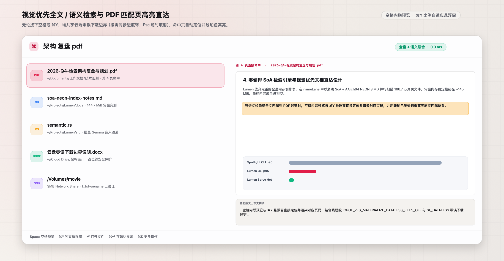
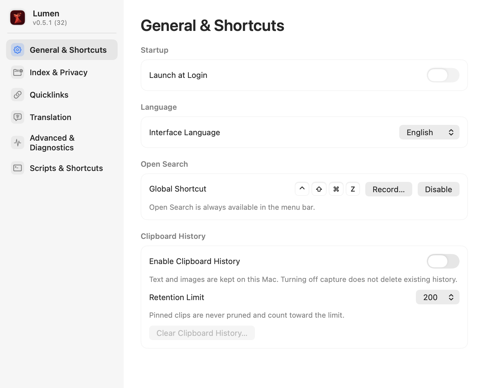

<p align="center">
  
</p>

<p align="center">
  
</p>

<h1 align="center">Lumen</h1>

<p align="center">
  <strong>One shortcut to search your entire Mac in milliseconds, jump straight to highlighted PDF pages, and run native workflows.</strong><br>
  Built natively with Rust and AppKit/SwiftUI—unifying million-file instant lookup, private offline AI &amp; image search, cloud-safe storage, and adaptive window tiling.
</p>

<p align="center">
  <a href="https://github.com/Surfire/Lumen/releases/tag/v0.7.0"></a>
  <a href="https://github.com/Surfire/Lumen/actions/workflows/ci.yml"></a>
  
  
  <a href="LICENSE"></a>
</p>

<p align="center">
  <a href="#try-it-in-30-seconds">30-Second Tour</a> ·
  <a href="#what-makes-lumen-different">Why Lumen</a> ·
  <a href="#interface-gallery">Gallery</a> ·
  <a href="#verified-performance--comparison">Benchmarks &amp; Comparison</a> ·
  <a href="#quick-install--docs">Install &amp; Docs</a> ·
  <a href="README.md">简体中文</a>
</p>

---

## Try It in 30 Seconds

| Try typing | What Lumen does immediately |
| :--- | :--- |
| `Q4 plan pdf` | Multi-keyword search filtered by real extension; wrap `"exact phrases"` in quotes |
| `xiangmu` / `xm` | Built-in Chinese pinyin or initials matching (`项目计划`), plus app abbreviations like `vsc` or `wx` |
| `cat` / `img sailboat` | Instant visual image recall from the main bar or explicit `img` multimodal search—100% offline |
| `Bluetooth` / `$100 to cny` / `ephemeral` | Open System Settings, evaluate cached FX/unit math locally, or view prefix-free Dictionary definitions |
| `?` / `win` | Browse built-in commands & orientation-aware window tiling with one-click batch restore |
| `cb` | Opt-in private clipboard history with instant previews for images, code files, URLs, and colors |
| `tr:zh Meeting postponed` | Streaming inline translation (`Return` copies; works with local oMLX / Ollama or OpenAI APIs) |
| `qa How to structure a review?` | Prompt-only local or custom AI Q&A; press `Esc` anytime with zero background file or web scraping |
| Summon inside Open/Save dialog | **Quick Switch** surfaces active Finder windows & whole-disk search to jump dialog paths cleanly |
| Folder `Tab` / `kh quote` | Multi-level folder scoping (space-safe) & project aliases; `⌘K` copies files, opens Terminal, or Open With |
| Select text & type `tr` / `qa` | Auto-attaches selection/Finder files/clipboard (`⌘↵` replaces text; `⌘⇧⌫` clears context anytime) |
| `sig` / `ribao` (Snippet alias) | Dedicated snippet library expands `{{date}}` / `{{time}}` / `{{clipboard}}` and pastes instantly |

---

## What Makes Lumen Different

### 1. Instant Whole-Disk Search (~1 ms Across 1.6M+ Files)
- **Zero Spotlight Lag**: Lumen runs its own lightweight in-memory index instead of waiting on macOS Spotlight. Across **1,667,692 real disk items**, lookups finish in **~1 ms** inside **~145 MiB** of RAM—and non-existent queries clear in **1.75 ms** without ever freezing the search bar.
- **Built-In Pinyin & Smart Initials**: Search Chinese filenames by full pinyin or initials (`xm` → `项目计划`) and launch apps by camelCase or word initials (`vsc`, `ps`, `wx`, `am`) out of the box.
- **Private Query Learning**: Remembers which app or file you pick for a specific query using local hashed affinity (no plaintext queries or paths stored in preferences), automatically prioritizing installed apps and active projects over old archive or backup folders.

### 2. Unified Visual Preview: Inline & Floating Auto-Scale
- **`⌘Y` Inline + `Space` Standalone Window Across Formats**: Press **`⌘Y`** on any supported file for an instant inline preview inside the search bar, or **`Space`** while browsing to open a floating window that scales to PDF crop boxes, image aspect ratios, and reading widths.
- **Instant Offline Rendering & Match Jump Across Docs**: Renders **Markdown** (local relative images and light/dark `<picture>` media, with external network badges kept offline so previews never spin), **Word / RTF**, multi-sheet **Excel**, **CSV / TSV**, source code, and **PDFs**—automatically jumping to and highlighting the matching page, paragraph, or spreadsheet tab.
- **Subtitle-to-Media Quick Jump**: When a search matches dialogue inside an `.srt` or `.vtt` subtitle file, use the context action menu to open the linked video or audio file immediately.

### 3. Private Offline AI & Complete Office Support
- **Search Inside Modern & Legacy Office + Subtitles**: Built-in full-text and semantic indexing covers PDF, modern Office (`.docx`, `.xlsx`, `.pptx` presentations up to 256 MB), legacy Office (`.doc`, `.xls`, `.ppt`, `.rtf`), subtitles (`.srt`, `.vtt`), and plain text with zero external helper dependencies.
- **1-Click Built-In Gemma 2 or Your Local oMLX / Ollama**: Download and verify the built-in **Gemma 2** text and image models in one click inside Settings (supporting both HuggingFace and **HF-Mirror**), or connect your own local **oMLX / Ollama** embedding endpoint on `127.0.0.1` while keeping Gemma 2 image search active independently.
- **Quiet Thermal Pacing & Smart Noise Filtering**: Background indexing automatically paces GPU usage around Mac thermal pressure and battery state so your fans stay quiet. Adding a folder automatically skips developer and AI clutter (`node_modules`, `target`, Python virtual environments, local model caches) while protecting personal note vaults (`Obsidian`, `Notes`, `Wiki`).

### 4. Safe by Design for Cloud Drives & NAS
- **Never Silently Downloads Cloud Files**: Online-only placeholders in iCloud Drive, OneDrive, and File Provider folders are cataloged by metadata without **ever** triggering unwanted background downloads. Explicit previews show a live download progress ring that you can cancel anytime with `Esc`.
- **Clean External Drive & SMB / NFS Support**: Manages physical USB/Thunderbolt drives separately from mounted SMB, NFS, AFP, and WebDAV network shares—never storing server credentials on disk.

### 5. Built-In Native Toolkit
- **Dialog Quick Switch, `Tab` Folder Scoping & `⌘K` File Actions**: Summon Lumen inside any app's Open/Save dialog to jump straight to open Finder folders or any searched folder without touching the clipboard or overwriting Save-As filenames. Press **`Tab`** on any folder to drill into space-safe breadcrumb scopes (`Backspace` pops, `Esc` clears), bind short project aliases (`kh quote`), and use `⌘K` to **copy actual file objects** (strict `SF_DATALESS` safe), **Open in Terminal**, or **Open With**.
- **Selection / Clipboard Context Pass-Through & Dedicated Snippets**: On summon, Lumen optionally captures frontmost selected text, Finder selections, or non-sensitive clipboard text (strictly skipping `AXSecureTextField` and password-manager markers) for `tr` (**`⌘↵` replace in place**), `qa` (**`⌘⇧⌫` strip context anytime**), quicklinks, and scripts. **Settings → Snippets** stores permanent templates with `{{date}}` / `{{time}}` / `{{datetime}}` / `{{clipboard}}` safely outside clipboard history eviction.
- **Adaptive Tiling (`win`), Clipboard & Everyday Sources**: Includes orientation-aware window tiling with reflow and batch restore, opt-in clipboard history (`cb`), `⌘Space` takeover once OS Spotlight is disabled, prefix-free macOS Dictionary, 0 ms cached FX conversions, multi-browser bookmarks, opt-in Contacts/Calendar/Reminders, and signed auto-updates with rollback.

---

## Interface Gallery

### Visual-First Search & Matched-Page PDF Highlighting (Light & Dark)

<p align="center">
  <picture>
    <source media="(prefers-color-scheme: dark)" srcset="assets/readme/search-dark.png">
    <source media="(prefers-color-scheme: light)" srcset="assets/readme/search-light.png">
    
  </picture>
</p>

### Native Settings Hub & Local AI Model Management (Light & Dark)

<p align="center">
  <picture>
    <source media="(prefers-color-scheme: dark)" srcset="assets/readme/settings-dark.png">
    <source media="(prefers-color-scheme: light)" srcset="assets/readme/settings-light.png">
    
  </picture>
</p>

### Adaptive Window Tiling, Rich Clipboard, Cloud/NAS Safety & Streaming Workflows

<p align="center">
  
</p>

---

## Verified Performance & Comparison

> **Reproducible Benchmarks**: All numbers below were measured on Apple Silicon hardware (Apple M5 Max · 128 GiB) using repository benchmark scripts. Full methodology and per-release telemetry: [Benchmark Protocol](docs/BENCHMARK.md), [Spotlight Comparison Report](benchmarks/v0.5.1-spotlight.md), [1M-File Baseline](benchmarks/v0.4-baseline.md), and [Changelog](CHANGELOG.md).

<p align="center">
  
</p>

### 1. Same-Machine Comparison: Lumen vs. macOS Spotlight (`mdfind`)

| Engine & Layer (150 Interleaved Queries) | p50 Latency | p95 Latency | p99 Latency | Memory & Notes |
| :--- | ---: | ---: | ---: | :--- |
| **macOS Spotlight (`mdfind` CLI)** | 42.78 ms | 46.51 ms | 50.08 ms | Built-in OS metadata CLI query |
| **Lumen CLI (`lumen query` cold start)** | **6.43 ms** | **7.76 ms** | **9.90 ms** | Fresh process per call (**6.0× faster p95 than Spotlight**) |
| **Lumen Persistent Service (GUI path)** | **0.013 ms** | **0.031 ms** | **0.057 ms** | **10.59 MiB** RSS; newly created 120-file folder indexed in **14.5 ms** |

### 2. Million-File Scale & Local AI Speedups at a Glance

| Workload | Corpus Scale | Measured Result | What It Means for You |
| :--- | :--- | :--- | :--- |
| **Whole-Disk Filename Lookup** | **1,667,692 real disk items** | Pinyin initials **0.79 ms** · Chinese 2-char **0.85–0.93 ms** · Empty miss **1.75 ms** | Instant keystroke response in **144.7 MiB** resident RAM |
| **Synthetic APFS Baselines** | **100,000 / 1,000,000 files** | 100K p95 **<= 0.18 ms** (**31.4 MiB**) · 1M p95 **<= 1.20 ms** (**137.6 MiB**) | **100%** Top-20 accuracy across 4,000 sampled queries |
| **Large-Scale Vector Scoring** | **699,050 × 768 vectors** | **5.65 ms** median scoring (**38× faster**), vector RAM halved to **1,024 MiB** | Near-instant semantic recall across hundreds of thousands of chunks |
| **Large Office & Quiet Indexing** | **21 MB `.pptx` / 1.67M corpus** | 21 MB presentation extracted in **11.8 ms** (**10.7 MiB** peak RAM); model RAM cut **>50%** | Fast large-deck indexing while background AI stays cool and quiet |

### 3. Detailed Comparison

| Dimension | **Lumen** | **macOS Spotlight** | **Raycast** | **Alfred** | **Oil Find** | **DigUp** |
| :--- | :--- | :--- | :--- | :--- | :--- | :--- |
| **Primary Focus** | Whole-disk ms search + matched-page PDF preview + native launcher | Built-in OS search | Extension-driven workflow launcher | Classic keyboard launcher | Ultra-lean dedicated file finder | Local multimodal document & media retrieval |
| **Filename Engine** | **Custom native in-memory index** (independent of Spotlight) | macOS background index | Relies on Spotlight | Relies on Spotlight | Custom C native scan & filter | Focused on chunk retrieval rather than disk launch |
| **Million-File RAM** | **~138–145 MiB** (measured on 1M–1.67M items) | OS background daemons | Light UI + OS index footprint | Light UI + OS index footprint | Ultra-low filename memory | Scales with vector DB & model weights |
| **Pinyin & Initials** | **Built-in** pinyin, initials & app abbreviations | Minimal OS heuristics | Requires community plugins | Requires custom workflows | Built-in pinyin & fuzzy match | Not focused on pinyin file launching |
| **Local AI & Office Search** | **Free built-in** PDF / modern & legacy Office / subtitles + **Gemma 2 / local oMLX & Ollama** | Keywords & metadata only | Cloud / paid Pro AI | Paid Powerpack + plugins | Free filename search; content/image search is **paid Pro** | **Free open-source** local multimodal search |
| **Matched PDF Page Preview** | **Jumps straight to matched page + amber highlights** | Opens file or basic preview | Standard Quick Look / extensions | Standard Quick Look | Path locator & basic preview | Passage snippets & chunk citations |
| **Cloud Safety & NAS** | **Strict zero auto-download guard** + USB & SMB/NFS shares | OS default provider policy | Follows Spotlight / Finder | Follows Spotlight / scripts | Avoids downloading cloud placeholders | Local & selected folders |
| **Quick Switch, Snippets & Tiling** | **Open/Save Quick Switch, `Tab` folder scope, selection pass-through, dedicated Snippets**, reflow tiling, clipboard, `tr`/`qa` | Basic calc & suggestions | **Top strength**: 1,000+ community extensions | **Strength**: Powerpack Workflows | File finding only (no tiling/clipboard) | Deep retrieval only (no launcher suite) |
| **License & Price** | **100% Free MIT Open Source** | Proprietary macOS | Free core; paid Pro tiers | Free core; paid Powerpack | Filename MIT; Pro closed/paid | **Free Open Source** |

- **Pick Lumen** if you want a 100% open-source native macOS launcher that replaces Spotlight lag with ~1 ms whole-disk search, Chinese pinyin, matched-page PDF highlighting, Open/Save Quick Switch, selection pass-through & Snippets, free offline AI & Office retrieval, cloud/NAS safety, and smart window tiling.
- **Pick Raycast / Alfred** if your daily workflow relies heavily on third-party SaaS extension ecosystems (Linear, Notion, Jira, Figma).
- **Pick Oil Find / DigUp** if you strictly need a minimal file-only locator (Oil Find) or a dedicated deep-parsing research tool (DigUp).

---

## Quick Install & Docs

### 1. Direct Download (Recommended)

Requires **Apple Silicon (M1 or newer)** and **macOS 14 Sonoma+**.

1. Download **`Lumen-macos-arm64.dmg`** (or `.zip`) from [GitHub Releases](https://github.com/Surfire/Lumen/releases/latest).
2. Drag **`Lumen.app`** into `/Applications` (optionally verify checksums via `shasum -a 256 -c SHA256SUMS.txt`).

> **First-Launch Note**: Community builds are not notarized with a paid Apple Developer ID. If macOS Gatekeeper blocks the first launch, run once in Terminal:
> ```sh
> xattr -dr com.apple.quarantine /Applications/Lumen.app
> ```

### 2. Homebrew Cask

Cask formula: [`packaging/homebrew/Casks/lumen.rb`](packaging/homebrew/Casks/lumen.rb) (`brew upgrade --cask lumen`; add `--zap` on uninstall to remove preferences and local indexes).

### 3. Build from Source

```sh
# 1. Quick development build & run
scripts/build-app.sh
open target/Lumen.app

# 2. Persistent local signing (preserves Accessibility & folder permissions across upgrades)
LUMEN_SIGN_IDENTITY="Lumen Local Code Signing" scripts/build-app.sh
python3 scripts/install-app.py install target/Lumen.app
open -a "$HOME/Applications/Lumen.app"
```

### 4. Documentation & Verification

- **User & Model Guides**: [Offline Semantics](docs/offline-gemma.md) · [Multimodal Image Search](docs/offline-image-search.md) · [Translation & Q&A Providers](docs/TRANSLATION.md) · [Upgrading & Rollback](docs/UPGRADING.md)
- **Engineering & Release Docs**: [Architecture](docs/ARCHITECTURE.md) · [Benchmark Protocol](docs/BENCHMARK.md) · [Compatibility](docs/COMPATIBILITY.md) · [Releasing Guide](docs/RELEASING.md) · [Changelog](CHANGELOG.md) · [Third-Party Licenses](THIRD_PARTY.md)

<details>
<summary>Expand local build, lint, and smoke verification commands</summary>

```sh
cargo fmt --check
cargo clippy --locked --all-targets -- -D warnings
cargo test --locked
scripts/build-app.sh
LUMEN_SMOKE=1 scripts/build-app.sh
python3 scripts/smoke-app.py
python3 scripts/smoke-launcher.py
python3 scripts/smoke-relaunch.py target/Lumen.app
python3 scripts/smoke-translation.py
python3 scripts/smoke-updater.py
python3 scripts/smoke-install-app.py
```

</details>

Released under the [MIT License](LICENSE). Independently implemented with product inspiration from Tinycast, Oil Find, DigUp, and Luminator Index.
