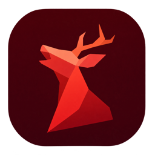
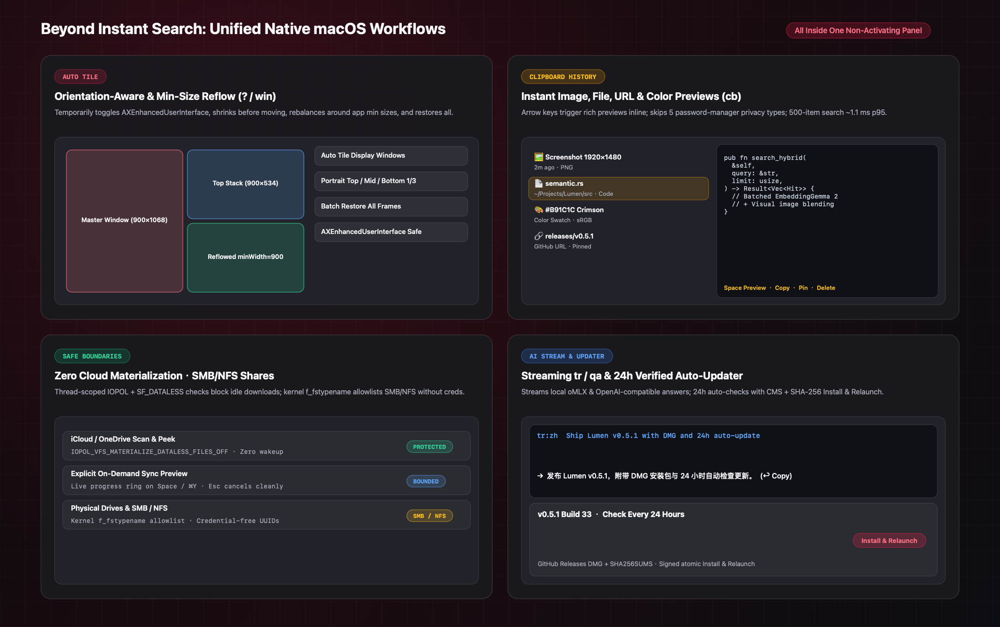
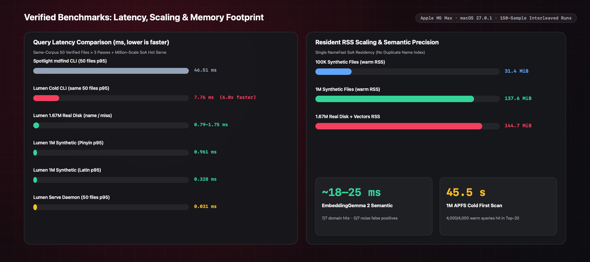

<p align="center">
  
</p>

<p align="center">
  
</p>

<h1 align="center">Lumen</h1>

<p align="center">
  <strong>One shortcut to search your entire Mac in milliseconds, jump straight to highlighted PDF pages, and run native macOS workflows.</strong><br>
  Powered by a custom zero-posting SoA + AArch64 NEON Rust engine and a non-activating AppKit / SwiftUI interface.<br>
  Unifies million-file name &amp; pinyin lookup, offline EmbeddingGemma 2 retrieval, SMB/NFS shares, adaptive window tiling, and strict zero-download cloud boundaries.
</p>

<p align="center">
  <a href="https://github.com/Surfire/Lumen/releases/tag/v0.6.0"></a>
  <a href="https://github.com/Surfire/Lumen/actions/workflows/ci.yml"></a>
  
  
  <a href="LICENSE"></a>
</p>

<p align="center">
  <a href="#key-capabilities--highlights">Features</a> ·
  <a href="#interface--workflow-gallery">Gallery</a> ·
  <a href="#verified-benchmarks--performance">Benchmarks</a> ·
  <a href="#detailed-comparison">Comparison</a> ·
  <a href="#quick-start--installation">Install</a> ·
  <a href="README.md">简体中文</a>
</p>

---

## 30-Second Command Tour

| Try typing | What Lumen does immediately |
| :--- | :--- |
| `Q4 plan pdf` | Multi-keyword match filtered by real PDF extension; quote for `"exact phrases"` |
| `luming` / `lm` | Full Chinese pinyin or initials lookup directly matching Chinese filenames |
| `deer` / `img sailboat` | Single-Han visual recall (`鹿`) or explicit `img` multimodal search—zero data leaves your Mac |
| `Bluetooth` / `25 km in mi` | Jump straight to System Settings or evaluate math/unit conversions—no index wait |
| `?` / `win` | Discover built-in commands & adaptive Accessibility window tiling / batch restore |
| `cb` | Rich opt-in clipboard history previewing images, code files, URLs, and colors |
| `tr:zh Meeting postponed` | Streaming inline translation (`Return` copies; local oMLX or OpenAI-compatible) |
| `qa How to structure a review?` | Prompt-only local/BYOK Q&A; `Esc` cancels cleanly with zero file/web leakage |

---

## Key Capabilities & Highlights

### 1. ~1 ms Disk-Wide Filename Search in ~145 MiB Resident RAM
- **Zero-Posting SoA + AArch64 NEON SIMD & External-Content FTS5**: Instead of holding bloated inverted posting tables or duplicating name indexes across lanes, Lumen keeps one compact structure-of-arrays (SoA) table scanned in parallel on `nameLane` (automatically scaling the `NameFast` budget to `512 MiB` on `>= 64 GB` Macs), backed on disk by an external-content FTS5 catalog (Schema v5, eliminating redundant `name_fts_content` shadow tables) with threshold-gated `VACUUM`; FSEvents adds per-parent `BurstCoalescer` holdback above `64 events/s` while keeping normal saves `<= 300 ms`.
- **Zero Fanout Stalls**: Measured on **1,667,692 real APFS items**, warm initials `lm` finish in **0.79 ms**, Chinese 2-char queries in **0.85–0.93 ms**, high-frequency single-Han fallbacks in **1.54–1.61 ms**, and negative misses (`哈基米`) settle in **1.75 ms** without freezing the launcher.
- **Query-Aware Hashed Frecency, App Initials & Live-File Ranking**: `LauncherFrecency` adds privacy-preserving `SHA-256` query-to-target affinity (`launcher.frecency.query.v1`, zero plaintext queries or paths persisted); `LaunchCatalog` automatically extracts word/camelCase initials & aliases (`vsc`, `ps`, `wx`, `am`); `INSTALLED_APP` ranking prioritizes formal bundles in `/Applications` while deprioritizing `backups`/`archive`/`作废归档` behind live files.

### 2. Visual-First Document Preview With Unified `Space` & `⌘Y`
- **Jump Straight to the Matched PDF Page**: Rather than dumping disconnected raw text snippets, PDF results open directly to the matching page rendered with translucent amber passage highlights above the text context.
- **Content-Proportional Quick Look (`⌘Y` / `Space`)**: Pressing `Space` while browsing results (while still typing normally while editing) or `⌘Y` shares one unified cloud-safe preview pipeline; Quick Look windows resize automatically to each item's true PDF CropBox, EXIF orientation, image dimensions, code, or media ratio, and `.srt`/`.vtt` subtitle hits expose **Open Linked Media** in context actions.

### 3. Unified Multimodal Semantic Index, Quiet Thermal Pacing & 1-Click Gemma
- **Unified Engine (PDF + Streaming OOXML + Pure-Rust Legacy Office & Subtitles)**: Documents and images share one **Semantic & Content Index**, streaming **`.docx` / `.xlsx` / `.pptx` (up to 256 MiB via `Read + Seek`, skipping `ppt/media/*` with a 32 MiB aggregate XML bomb budget)** alongside zero-subprocess **pure-Rust `.doc` / `.xls` / `.ppt` / `.rtf` and `.srt` / `.vtt`** extractors using dynamic `(cpus * 2 / 3).clamp(4, 12)` workers. Both text and image semantic matrices now reside in packed `f16` (`Vec<u16>`) scored with AArch64 NEON `fcvtl`/`vfmaq_f32` and multi-threaded row slicing (**halving matrix RAM from `2,048 MiB` to `1,024 MiB` and cutting `699,050 × 768` scoring from `215.23 ms` to `5.65 ms` (`38.07×`) on M5 Max**).
- **Quiet Thermal/Battery Pacing & Slimmer Runtime Context (v0.5.4 / v0.5.5)**: Darwin `thermalpressurelevel` and IOKit power-source pacing yields GPU cooldown slices between `--stream` batches (gentle 2.0× nominal AC duty cycle); `llama-server` drops unused 8 GiB prompt caching and busy polling (`--cache-ram 0 --poll 0`) while trimming to 2 slots (`--parallel 2 --ctx-size 4096`, keeping `--ubatch-size 2048` aligned with slot context); `gemma_pending_chunk` eliminates $O(N^2)$ SQLite table scans; opaque thumbnails use JPEG `0.85` (preserving PNG alpha) with 2-slot concurrent encoding.
- **Smart AI Workstation / Frame-Dump & Venv Noise Skip**: Read-only `preview-content-scope` surfaces concise noise reason tags (`AI Runtime`, `Frame Dump`, `Image Dump`, `High Volume`) while automatically sparing knowledge-base directories (`obsidian`/`notes`/`vault`/`wiki`/`knowledge`). Automatically skips `node_modules`, `target`, `dist`, `build`, `comfyui`, `huggingface`, `modelscope`, `.ollama`/`.omlx`, `/Users/Deleted Users`, Python `*venv*` / PEP 405 `pyvenv.cfg` trees, and transient `-wal`/`-shm`/`-journal`/`.part`/`.crdownload`/`~$*` files; keeps **source code off by default** with custom allow/deny rules tucked inside a collapsed `DisclosureGroup`.
- **1-Click Verified Model Installer**: Pick **HuggingFace** or **HF-Mirror** (automatically selected by default in mainland China timezones) right inside Settings while respecting system proxies, or import local weights; every binary, GGUF model, and runtime dylib is verified by exact size and SHA-256 before activation.

### 4. Zero Cloud Materialization + Physical Drives & SMB / NFS Shares
- **Kernel-Enforced Cloud Safety**: Every scan, extraction, preview, and diagnostic call binds `IOPOL_VFS_MATERIALIZE_DATALESS_FILES_OFF`, `SF_DATALESS`, and `O_NOFOLLOW_ANY`. iCloud Drive, OneDrive, and File Provider online-only placeholders are cataloged without **ever** triggering unwanted background downloads; explicit preview shows a live hydration progress ring with `Esc` cancellation.
- **Physical Drives & Network Mounts Split Cleanly**: Physical USB/Thunderbolt volumes and `/Volumes/*` NAS mounts (SMB / NFS / AFP / WebDAV) are cleanly separated—network identities derive deterministically from credential-free URIs, and preview checks verify an explicit kernel `f_fstypename` allowlist instead of path prefixes.

### 5. Adaptive Window Management & Smart Reflow (`?` / `win`)
- **Orientation-Aware Tiling & Batch Restore**: Landscape 3-window uses 55% Master + stacked right split; portrait screens split top/bottom halves or thirds (`top-third` / `middle-third` / `bottom-third`); ultrawides support 3-column and `3×2` grids—all reversible with a single `Restore`.
- **Solves Real macOS Resize Quirks**: Temporarily disables `AXEnhancedUserInterface` on Chromium/Electron/IDE windows during frame mutation and restores it safely via `defer`, contracts before moving to avoid screen-edge clamping, retries post-move resizes, prioritizes the active window for the Master slot, and runs 2-pass **minimum-size Reflow** when an app enforces a `minWidth` or `minHeight` larger than its initial slot.

### 6. Native Launcher Hub & 24h Verified Auto-Updates
- Unifies **rich private clipboard history** (5 password-manager privacy markers, ~1.1 ms p95 across 500 items, inline image/code/URL/color previews), **Light / Dark / System appearance**, streaming `tr` / `qa`, quicklinks, calc/unit conversion, local scripts & Apple Shortcuts, and cohesive 24h updates in `LauncherUpdater` (CMS + SHA-256 **Install & Relaunch** for signed builds; strict HTTP-404 fallback to `lumen-update.json` opening the GitHub Release page safely for ad-hoc builds).

---

## Interface & Workflow Gallery

### Visual-First Search & Matched-Page PDF Highlighting (Light & Dark)

<p align="center">
  <picture>
    <source media="(prefers-color-scheme: dark)" srcset="assets/readme/search-dark.png">
    <source media="(prefers-color-scheme: light)" srcset="assets/readme/search-light.png">
    
  </picture>
</p>

### Unified Semantic Index & 1-Click Gemma Installer (Real Build 33 Capture)

<p align="center">
  <picture>
    <source media="(prefers-color-scheme: dark)" srcset="assets/readme/settings-dark.png">
    <source media="(prefers-color-scheme: light)" srcset="assets/readme/settings-light.png">
    
  </picture>
</p>

### Adaptive Window Tiling, Rich Clipboard, Cloud/NAS Boundaries & Streaming Workflows

<p align="center">
  
</p>

---

## Verified Benchmarks & Performance

> **Measurement Discipline**: All numbers below were measured on real Apple Silicon hardware using reproducible repository scripts, strictly separating same-layer CLI invocations, persistent `lumen serve` daemon latency, and million-file synthetic/real-disk baselines. Methodology: [docs/BENCHMARK.md](docs/BENCHMARK.md).

<p align="center">
  
</p>

### 1. Same-Machine, Same-Corpus: Lumen vs. macOS Spotlight (`mdfind`)
Hardware: **Apple M5 Max · 128 GiB RAM · macOS 27.0.1 · commit `81385f7`**. Both Spotlight (`mdfind`) and Lumen were verified to cover the exact same open-source tree before running **50 unique filenames × 3 interleaved passes = 150 queries/layer** (full report: [benchmarks/v0.5.1-spotlight.md](benchmarks/v0.5.1-spotlight.md)):

| Engine & Layer | Samples | p50 (ms) | p95 (ms) | p99 (ms) | Max (ms) | Scope & Capability Notes |
| :--- | ---: | ---: | ---: | ---: | ---: | :--- |
| **macOS Spotlight (`mdfind` CLI)** | 150 | 42.782 | 46.508 | 50.077 | 60.000 | OS metadata daemon CLI query |
| **Lumen CLI (`lumen query` cold CLI)** | 150 | **6.431** | **7.756** | **9.902** | **10.127** | Fresh process + DB open each call (**6.00x faster p95**) |
| **Lumen Daemon (`lumen serve` hot)** | 150 | **0.013** | **0.031** | **0.057** | **0.078** | Warm JSONL stdio path used by GUI (**10.59 MiB** RSS) |
| Newly created 120-file directory | — | — | — | — | — | `mds` reported `Spotlight_not_fully_ready` (`0/120` within 50s); Lumen scanned repo in **14.54 ms** |

### 2. 1.67M Real-Disk Index & 100K / 1M Synthetic APFS Baselines

<details>
<summary>Expand full tables: 1,667,692 real disk items + 100K / 1M APFS baselines (v0.4 / v0.5)</summary>

#### A. 1,667,692 Real Disk Items (2,370 Documents + 43,690 EmbeddingGemma Vectors)

| Query / Resource Metric | Measured | Notes |
| :--- | ---: | :--- |
| Chinese pinyin initials (`lm`) | **0.79 ms** | `mode=name`, warm Top 60 |
| Chinese 2-character (`临床` / `项目` / `工作` / `报告`) | **0.85–0.93 ms** | Parallel AArch64 NEON zero-posting scan |
| Latin filename (`readme`) | **1.10 ms** | `mode=name`, warm |
| High-frequency / single-Han (`方案` / `方`) | **1.54–1.61 ms** | Full 1.67M scan without degradation |
| Negative miss (`哈基米`) | **1.75 ms** | Fast empty settlement |
| `lumen serve` resident RSS | **144.7 MiB** | Single `NameFast` residency |
| Document full-text (`方案` / miss `哈基米`) | **46.61 ms** / **0.16 ms** | `mode=text` + FTS5 |
| Offline EmbeddingGemma 2 recall (14-query sweep) | **~18–25 ms** | 7/7 in-domain hits; **0/7 noise false positives** |

#### B. 100K & 1M Synthetic APFS Baselines ([benchmarks/v0.4-baseline.md](benchmarks/v0.4-baseline.md))

| Scale | Cold Scan | Warm `lumen serve` RSS | Latin p95 | Chinese p95 | Pinyin p95 | Multiword p95 | Top-20 Accuracy |
| :--- | ---: | ---: | ---: | ---: | ---: | ---: | ---: |
| **100,000 files** | 3,936.11 ms | **31.42 MiB** | 0.037 ms | 0.180 ms | 0.179 ms | 0.035 ms | 4,000 / 4,000 (100%) |
| **1,000,000 files** | 45,503.66 ms | **137.58 MiB** | 0.328 ms | 1.195 ms | 0.961 ms | 0.342 ms | 4,000 / 4,000 (100%) |

</details>

### 3. v0.5.4 Background Multimodal Indexing & Thermal-Pacing Telemetry (Apple M5 Max · 128 GiB)
Measured on the live 1.67M-item corpus (76k documents, 18,696 indexed local images, `embeddinggemma-2-Q8_0`):

| Metric | Before (`v0.5.3`) | After (`v0.5.4`) | Notes |
| :--- | :--- | :--- | :--- |
| `llama-server` RSS footprint | `2,660 MB` (~2.66 GB) | **`1,182–1,266 MB`** | `--cache-ram 0 --poll 0` eliminates unused cache bloat (**-52% to -55%**) |
| Pending chunk SQLite query | `82 ms` full 323k scan | **`0.05 ms`** (`ROWID` search) | Materialized `gemma_pending_chunk` queue eliminates $O(N^2)$ scans |
| `lumen embed` host CPU | `5%–38%` | **`0.8%–2.5%`** | Eliminates repeated queue scans & polling; zero thermal warnings |
| `sample` stack sleep ratio | `0%` (nonstop GPU burn) | **`~66%` resting** (950 vs 489) | Darwin thermal/battery pacer yields cooldown slices between batches |
| Net text throughput | ~`64 chunks/s` | **~`72 chunks/s`** (+2,080 in 29s) | Faster net progress despite resting >50% of wall time |

### 4. v0.6.0 Packed `f16` NEON Scoring & Streaming Large-Office Benchmarks (Apple M5 Max · 128 GiB)
- **`699,050 × 768` semantic vector matrix scoring (`rustc -O`: `v0.5.5` unpacked `Vec<f32>` vs. `v0.6.0` packed `Vec<u16>` NEON + parallel)**: Matrix RAM drops from **`2,048.0 MiB` to `1,024.0 MiB` (-50%)**, while median query scoring latency drops from **`215.23 ms` to `5.65 ms` (`38.07×` speedup**, max abs diff `1.05e-05`).
- **Streaming large `.pptx` & pure-Rust legacy Office (isolated test)**: Extracting a `21 MiB` `.pptx` with a `20 MiB` embedded media payload takes **`11.8 ms`** at **`10.7 MiB`** peak RSS, unlocking `.pptx` up to **256 MiB** alongside zero-subprocess `.doc`/`.xls`/`.ppt`/`.rtf`/`.srt`/`.vtt` extraction and text search.

---

## Detailed Comparison

| Dimension | **Lumen** | **macOS Spotlight** | **Raycast** | **Alfred** | **Oil Find** | **DigUp** |
| :--- | :--- | :--- | :--- | :--- | :--- | :--- |
| **Primary Strength** | Whole-disk ms search + page-level doc preview + native launcher | Built-in OS search | Marketplace of workflow extensions | Classic keyboard launcher | Ultra-lean dedicated file finder | Local multimodal document/media retrieval |
| **Filename Search Engine** | Custom **Rust zero-posting SoA + NEON** (independent of `mds`) | macOS `mds` / `mdimporter` | Relies on Spotlight (`mdfind`) | Relies on Spotlight (`mdfind`) | Custom **C + NEON** scan & filter | Chunk-level semantic index rather than disk launcher |
| **Million-File RAM** | **~138–145 MiB** (measured on 1M–1.67M items) | OS background daemons | Light UI + OS `mds` footprint | Light UI + OS `mds` footprint | Ultra-low filename residency | Scales with local weights & vector DB |
| **Pinyin & Initials** | **Built-in** pinyin, camelCase & word initials (`lm`/`vsc`/`wx`) | Very limited OS heuristics | Requires third-party extensions | Requires community workflows | Built-in pinyin & fuzzy matching | Not focused on pinyin file launch |
| **Doc FTS & Local AI** | **Free built-in** FTS (PDF + streaming `.docx`/`.xlsx`/`.pptx` up to 256 MB + pure-Rust `.doc`/`.xls`/`.ppt`/`.rtf` + `.srt`/`.vtt`) + **EmbeddingGemma 2** (`f16` NEON + 1-click downloader) | Keyword/metadata only | Cloud/Pro subscription AI | Paid Powerpack + plugins | Free filename/external; content/image search is **paid Pro** | **Free open-source** EmbeddingGemma 2 |
| **Matched PDF Page + Highlight** | **Jumps to matched page + amber inline highlight** | Opens file or basic search | Standard Quick Look / extensions | Quick Look | Focuses on paths & basic preview | Passage snippets & chunk citations |
| **Space / `⌘Y` Aspect Parity** | Unified cloud boundary + CropBox/EXIF window scaling | Native Quick Look | Extensions / Quick Look | Quick Look | Fast path locator | Built-in preview cards |
| **Zero Cloud Download Guard** | Thread `IOPOL` + `SF_DATALESS` + explicit Esc-cancel sync | Provider-managed | Follows `mdfind` / Finder | Follows `mdfind` / scripts | Inspects cloud placeholder flags | Operates on chosen local dirs |
| **External Drives & SMB/NFS** | Separate Physical & SMB/NFS types + kernel `f_fstypename` | Depends on share indexing | Depends on Spotlight coverage | Spotlight or custom scripts | **Strength**: offline volume catalogs | Local & mounted folders |
| **Tiling, Clipboard & Suite** | **Min-size Reflow auto-tiling**, rich clipboard, `tr`/`qa`, scripts/Shortcuts | Basic calc & web | **Top strength**: 1,000+ community extensions | **Strength**: Powerpack Workflows | File finding only (no tiling/clipboard) | Focused on deep retrieval |
| **License & Cost** | **100% Free MIT Open Source** | Proprietary macOS | Free core; Pro paid tiers | Free core; Powerpack paid | Filename MIT; Pro closed/paid | **Free Open Source** |

- **Pick Lumen** if you want an open-source macOS launcher that replaces Spotlight lag and misses with ~1 ms SoA+NEON search, Chinese pinyin, matched-page PDF highlighting, free offline Gemma 2 multimodal retrieval, SMB/NFS safety, and smart window tiling in one native app.
- **Pick Raycast / Alfred** if your daily workflow depends heavily on SaaS extension ecosystems (Linear, Notion, Jira, etc.).
- **Pick Oil Find / DigUp** if you strictly want a minimal C-speed file-only finder (Oil Find) or a dedicated deep-parsing research pipeline (DigUp).

---

## Quick Start & Installation

### 1. Direct Download (Recommended for Early Testers)

Requires **Apple Silicon** and **macOS 14 Sonoma+**.

1. Download **`Lumen-macos-arm64.dmg`** (or `.zip`) from [GitHub Releases](https://github.com/Surfire/Lumen/releases/latest).
2. *(Optional)* Verify checksums with `shasum -a 256 -c SHA256SUMS.txt`.
3. Drag **`Lumen.app`** into `/Applications`.

> **First-launch note (Community ad-hoc Path B build)**: Without Apple Developer notarization, macOS Gatekeeper may block the first launch. Run once in Terminal:
> ```sh
> xattr -dr com.apple.quarantine /Applications/Lumen.app
> ```

### 2. Homebrew Cask

Cask definition: [`packaging/homebrew/Casks/lumen.rb`](packaging/homebrew/Casks/lumen.rb) (`brew upgrade --cask lumen`; pass `--zap` on uninstall to wipe preferences and index).

### 3. Build from Source & Persistent Local Signing

For daily self-builds that preserve Accessibility and folder permissions across upgrades:

```sh
# Development ad-hoc run
scripts/build-app.sh
open target/Lumen.app

# Persistent named identity + atomic in-place install
LUMEN_SIGN_IDENTITY="Lumen Local Code Signing" scripts/build-app.sh
python3 scripts/install-app.py install target/Lumen.app
open -a "$HOME/Applications/Lumen.app"
```

### 4. Auto-Updates & Configuration Docs

- **24h Auto-Update Checks**: Configurable under **Settings → Advanced & Diagnostics** and the menu bar item. Release-signed copies verify CMS signature + ZIP SHA-256 before atomic **Install & Relaunch** (with automatic backup rollback); community ad-hoc builds fall back strictly on HTTP 404 to `lumen-update.json` and open the GitHub Release page safely.
- **Model & Endpoint Guides**: [Offline Semantics](docs/offline-gemma.md) · [Multimodal Image Search](docs/offline-image-search.md) · [Translation & Q&A Providers](docs/TRANSLATION.md)

---

## Architecture, Docs & Verification

[Architecture](docs/ARCHITECTURE.md) · [Compatibility](docs/COMPATIBILITY.md) · [Local Upgrades & Rollback](docs/UPGRADING.md) · [Releasing Guide (Path B → Path A)](docs/RELEASING.md) · [Changelog](CHANGELOG.md) · [Third-Party Dependencies](THIRD_PARTY.md)

<details>
<summary>Full build, lint, unit, and smoke verification gates</summary>

```sh
cargo fmt --check
cargo clippy --locked --all-targets -- -D warnings
cargo test --locked
scripts/build-app.sh
LUMEN_SMOKE=1 scripts/build-app.sh
python3 scripts/smoke-app.py
python3 scripts/smoke-launcher.py
python3 scripts/smoke-relaunch.py target/Lumen.app
python3 scripts/smoke-translation.py
python3 scripts/smoke-updater.py
python3 scripts/smoke-install-app.py
```

Synthetic corpora are used throughout; AppKit focus and FSEvents tests require an unlocked interactive macOS desktop session.

</details>

Released under the [MIT License](LICENSE). Independently implemented with product inspiration from Tinycast, Oil Find, DigUp, and Luminator Index.
