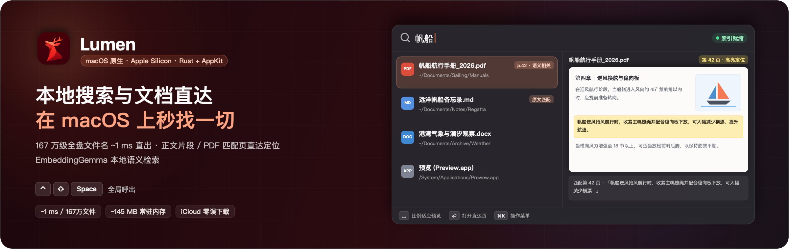

<p align="center">
  
</p>

<p align="center">
  
</p>

<h1 align="center">Lumen · 鹿鸣</h1>

<p align="center">
  <strong>一个快捷键，毫秒定位全盘文件、直达 PDF 原页高亮答案，并掌管 macOS 日常效率工作流。</strong><br>
  Rust 零倒排 SoA + AArch64 NEON 原生检索引擎，搭配 SwiftUI / AppKit 极简非抢占界面。<br>
  将百万级文件毫秒查找、EmbeddingGemma 2 多模态语义检索、SMB/NFS 共享、智能自适应分屏与云盘零误下载边界融为一体。
</p>

<p align="center">
  <a href="https://github.com/Surfire/Lumen/releases/tag/v0.5.4"></a>
  <a href="https://github.com/Surfire/Lumen/actions/workflows/ci.yml"></a>
  
  
  <a href="LICENSE"></a>
</p>

<p align="center">
  <a href="#核心产品亮点与特性">核心亮点</a> ·
  <a href="#界面与工作流实景">界面预览</a> ·
  <a href="#实测性能与内存对比">性能实测</a> ·
  <a href="#同类工具深度对比">竞品对比</a> ·
  <a href="#快速上手与种子用户安装">快速安装</a> ·
  <a href="README.en.md">English</a>
</p>

---

## 30 秒上手指令速览

| 试着输入 | 立即完成什么 |
| :--- | :--- |
| `年报 复盘 pdf` | 多关键词同框秒查 + 真实扩展名过滤；支持双引号 `"精确短语"` |
| `luming` / `lm` | 全拼或首字母直接定位中文文件名「鹿鸣」及路径目录 |
| `鹿` / `img 帆船` | 主框单字直接防抖唤起高相关视觉召回，或以 `img` 显式跨模态搜图与文档，全程零数据上传 |
| `蓝牙` / `25 km in mi` | 无需等待文件索引，直接跳转系统设置或本地实时计算/单位换算 |
| `?` / `win` | 浏览内置命令与自适应窗口管理（智能分屏、竖屏三分之一、批量恢复） |
| `cb` | 富媒体私密剪贴板历史，方向键选中即出图片、代码文件与色值预览 |
| `tr:en 会议改期了` | 同输入框流式翻译，回车一键复制结果（支持本机 oMLX 与 OpenAI 兼容服务） |
| `qa 如何整理周报结构` | 本机大模型纯提示词问答，按 `Esc` 立即取消，绝不联网抓取或泄漏文件 |

---

## 核心产品亮点与特性

### 1. 百万级文件名约 1 ms 响应，常驻内存压至 ~145 MiB
- **零倒排紧凑 SoA + AArch64 NEON**：抛弃冗重的内存倒排索引与多通道重复副本，仅在 `nameLane` 维护一套按数组结构（SoA）排布的紧凑名称表，并用 ARM64 NEON SIMD 并行扫描。
- **高扇出与空排不卡顿**：在 **1,667,692 条真实磁盘项目** 上，拼音首字母 `lm` 仅 **0.79 ms**，中文双字 **0.85–0.93 ms**，高频单字回退 **1.54–1.61 ms**，不存在关键词（如 `哈基米`）**1.75 ms** 立即排空，彻底告别“输入后卡 1–2 秒才显示无结果”。

### 2. 视觉优先预览：PDF 匹配页高亮直达，空格与 `⌘Y` 体验统一
- **直达页码 + 琥珀色原页高亮**：检索到 PDF 文档时，内联预览与独立预览窗不再只展示冷冰冰的纯文本摘录，而是直接渲染对应命中页，并在原页面上用琥珀色高亮匹配段落（下方附全文上下文）。
- **比例自适应悬浮窗**：按 **`⌘Y`** 呼出独立 Quick Look 悬浮窗（打字时不抢空格，浏览结果时按 **`空格`** 即可触发内联/悬浮预览），自动识别 PDF CropBox、页面旋转角、图片像素/EXIF 方向与文档/代码比例。
- **统一的云盘按需同步边界**：无论在普通搜索还是剪贴板文件列表中按 `空格` 或 `⌘Y`，遇到未下载云端文件均执行同一套安全同步流程，显示进度环并支持随时按 `Esc` 取消。

### 3. 统一多模态语义索引、静音温控、智能降噪与一键下载 Gemma
- **正文与图片统一引擎 & 公平调度**：将文档与图片目录收口至同一「语义与内容索引」配置，按文件修改时间倒序推进并采用随物理内存动态伸缩的向量预算（128 GiB 机型约 69.9 万正文片段 / 34.9 万图像向量）。冷启动先预热 `64` 张最新图片，随后在后台按「正文 `100` 批 ↔ 图像 `16` 批」公平交替推进；安装 `mmproj` 后支持主框单字视觉召回与跨模态结果融合。
- **后台静音温控与算力优化（v0.5.4）**：基于 Darwin `thermalpressurelevel` 与 IOKit 电源状态在批间自动让出 GPU，消除长期风扇狂转；`llama-server` 禁用无用的 8 GiB Prompt Cache 与忙等轮询（`--cache-ram 0 --poll 0`，常驻内存直接减半），`gemma_pending_chunk` 物化队列消除 $O(N^2)$ 全表扫，不透明图像改传 JPEG `0.85` 缩略图并启用双槽并发编码。
- **默认跳过开发噪音 + 渐进式规则**：添加工程/工作目录时支持先只读预扫目录文件分布，一键排除高噪音子目录；默认跳过 `node_modules`、`target`、`dist`、`build`、锁文件、压缩产物与中间文本，且**默认关闭源码索引**；其余自定义扩展名与路径规则统一折叠于「高级过滤规则…」。
- **内置 1-Click Gemma 下载与校验器**：无需命令行配置 Python/脚本，在设置页选择 **HuggingFace** 或国内 **HF-Mirror** 源即可一键下载模型、多模态投影器与推理运行时（保留系统代理），全程强制验证 SHA-256 与精确字节大小；也支持本地已下载文件一键导入。

### 4. 网盘零误下载硬边界 + 物理外置盘 & SMB / NFS 网络共享
- **内核级零唤醒保证**：扫描、文本提取、预览与诊断线程全链路强制 `IOPOL_VFS_MATERIALIZE_DATALESS_FILES_OFF`、`SF_DATALESS` 校验与 `O_NOFOLLOW_ANY`。已识别的 iCloud Drive、OneDrive 与 File Provider 目录仅记录可见元数据，**绝不偷偷触发云端文件自动下载**。
- **外置卷与 NAS 共享拆分管理**：独立区分物理外置移动盘与 `/Volumes/*` 网络挂载（SMB / NFS / AFP / WebDAV），基于脱敏来源 URI 派生稳定目录 UUID、绝不落盘存储账号密码；网络共享预览通过 `fstatfs` `f_fstypename` 显式内核白名单放行，兼顾 NAS 大库查阅与安全隔离。

### 5. 横竖屏智能自适应分屏（`?` / `win`）
- **贴合真实屏幕形态**：横屏 3 窗采用「左侧 55% 主活动窗口 + 右侧上下双栏」，竖屏自动切为「上下半屏 / 上中下三分屏」，超宽屏支持 3 列与 `3×2` 网格；全部支持一键 `恢复原窗口大小`（批量还原到分屏前位置与尺寸）。
- **解决真实窗口调整顽疾**：针对 Electron / Chromium / IDE 窗口调整期间临时关闭 `AXEnhancedUserInterface` 并在完成后精确恢复；收缩窗口时先缩再移防贴边夹紧；若某些应用强制最小宽高（`minWidth` / `minHeight`）超出初始格子，两阶段 **Reflow 重排** 会读回真实尺寸并自动重算相邻窗口比例，不留重叠或大块空隙。

### 6. 全能原生效率中枢 & 24h 自动校验更新
- 整合：**私密剪贴板历史**（默认关闭隐私保护、屏蔽 5 类密码管理器标记、500 条模糊搜 p95 ~1.1 ms、图片/文件/URL/色值即时预览）、**浅色/深色/跟随系统**外观、**流式翻译与问答（`tr` / `qa`）**、**快捷链接 & 本地脚本 / Apple 快捷指令**、以及内聚于 `LauncherUpdater` 的 **24 小时自动检查更新**（正式签名版校验 CMS + SHA-256 后一键「安装并重启」并支持回滚备份；社区 ad-hoc 构建在 `.cms` 返回 404 时严格只读降级 `lumen-update.json` 提示并跳转 Release 页面）。

---

## 界面与工作流实景

### 视觉优先检索 & PDF 匹配页高亮（深浅色自适应）

<p align="center">
  <picture>
    <source media="(prefers-color-scheme: dark)" srcset="assets/readme/search-dark.png">
    <source media="(prefers-color-scheme: light)" srcset="assets/readme/search-light.png">
    
  </picture>
</p>

### 统一多模态语义索引 & 一键 Gemma 下载器（实机 Build 33 截图）

<p align="center">
  <picture>
    <source media="(prefers-color-scheme: dark)" srcset="assets/readme/settings-dark.png">
    <source media="(prefers-color-scheme: light)" srcset="assets/readme/settings-light.png">
    
  </picture>
</p>

### 智能分屏、富媒体剪贴板、云盘/NAS 边界与流式工作流

<p align="center">
  
</p>

---

## 实测性能与内存对比

> **测试声明**：全部数据均在本机 Apple Silicon 环境跑出，可由仓库脚本复现；严格区分 **冷 CLI 进程对比**、**常驻 JSONL 服务（`lumen serve`）** 与 **百万级全盘合成/实盘基准**，绝不混层比较。评测规范详见 [基准协议](docs/BENCHMARK.md)。

<p align="center">
  
</p>

### 1. 同机同库对照：Lumen vs macOS Spotlight（`mdfind`）
测试环境：**Apple M5 Max · 128 GiB RAM · macOS 27.0.1 · 提交 `81385f7`**。两者均事先确认完整覆盖同一公开仓库文件树，随机交错执行 **50 组唯一文件名 × 3 轮 = 150 次查询/通道**并逐条校验返回真实路径（详见 [v0.5.1 Spotlight 对照报告](benchmarks/v0.5.1-spotlight.md)）：

| 引擎与调用层（同等口径对照） | 样本数 | p50 (ms) | p95 (ms) | p99 (ms) | Max (ms) | 说明与能力差异 |
| :--- | ---: | ---: | ---: | ---: | ---: | :--- |
| **macOS Spotlight（`mdfind` CLI）** | 150 | 42.782 | 46.508 | 50.077 | 60.000 | 系统元数据索引 CLI 耗时 |
| **Lumen CLI（`lumen query` 同层冷启）** | 150 | **6.431** | **7.756** | **9.902** | **10.127** | 每次重新冷启动进程 + 查库，**p95 比 `mdfind` 快 6.00 倍** |
| **Lumen 常驻服务（`lumen serve` 热通道）** | 150 | **0.013** | **0.031** | **0.057** | **0.078** | GUI 实际使用的常驻内存通道（RSS 仅 **10.59 MiB**） |
| 新建目录即时可查（120 个文件） | — | — | — | — | — | `scripts/compare-spotlight.py` 中 `mds` 50 秒内尚未完成摄入（`0/120`）；Lumen 全仓冷扫仅 **14.54 ms** |

### 2. 166.7 万真实磁盘全盘 & 10 万 / 100 万合成 APFS 压测

<details>
<summary>展开完整数据表：1,667,692 真实磁盘文件实测 + 100K / 1M APFS 基线（v0.4 / v0.5）</summary>

#### A. 1,667,692 条真实磁盘项目实测（包含 2,370 份正文档与 43,690 条 Gemma 向量）

| 查询与资源项 | 实测结果 | 说明 |
| :--- | ---: | :--- |
| 拼音首字母名称查询（`lm`） | **0.79 ms** | `mode=name` 热态 Top 60 |
| 中文双字名称查询（`临床` / `项目` / `工作` / `报告`） | **0.85–0.93 ms** | NEON 零倒排并行扫描 |
| 英文名称查询（`readme`） | **1.10 ms** | `mode=name` 热态 |
| 高频词 / 单字回退（`方案` / `方`） | **1.54–1.61 ms** | 166.7 万全盘无退化 |
| 不存在关键词名称排空（`哈基米`） | **1.75 ms** | 快速排空，不卡界面 |
| 常驻检索服务进程内存（`lumen serve` RSS） | **144.7 MiB** | 单一 `NameFast` 常驻实例 |
| 正文全文热查询（`方案` / 无匹配 `哈基米`） | **46.61 ms** / **0.16 ms** | `mode=text` + FTS5 |
| 本地 EmbeddingGemma 2 语义召回（14 组盲测） | **~18–25 ms** | 7/7 相关查询命中；7/7 无关词返回 **0 误报** |

#### B. 10 万 & 100 万真实 APFS 合成文件基线（详见 [v0.4-baseline.md](benchmarks/v0.4-baseline.md)）

| 规模 | 首次全量扫描 | 常驻 RSS（`lumen serve`） | 拉丁 p95 | 中文 p95 | 拼音 p95 | 多词 p95 | Top-20 准确率 |
| :--- | ---: | ---: | ---: | ---: | ---: | ---: | ---: |
| **100,000 文件** | 3,936.11 ms | **31.42 MiB** | 0.037 ms | 0.180 ms | 0.179 ms | 0.035 ms | 4,000 / 4,000 (100%) |
| **1,000,000 文件** | 45,503.66 ms | **137.58 MiB** | 0.328 ms | 1.195 ms | 0.961 ms | 0.342 ms | 4,000 / 4,000 (100%) |

</details>

### 3. v0.5.4 后台多模态索引静音与内存实测（Apple M5 Max · 128 GiB）
在真实 166.7 万文件（7.6 万文档、18,696 张已索引图片、`embeddinggemma-2-Q8_0`）工作库上的对比实测：

| 指标 | 优化前（`v0.5.3`） | 优化后（`v0.5.4`） | 变化说明 |
| :--- | :--- | :--- | :--- |
| `llama-server` 内存（RSS） | `2,660 MB`（~2.66 GB） | **`1,182–1,266 MB`** | `--cache-ram 0 --poll 0` 砍掉缓存与忙等（**-52%~-55%**） |
| 待嵌队列 SQL 查询 | `82 ms` 全扫描 32.3 万行 | **`0.05 ms`**（`ROWID` 驱动） | `gemma_pending_chunk` 物化表消除 $O(N^2)$ 扫表 |
| `lumen embed` CPU 占用 | `5%–38%` | **`0.8%–2.5%`** | 消除重复扫表与盲等，无任何热告警 |
| `sample` 调用栈休眠占比 | `0%`（零休眠死跑 GPU） | **`~66%` 休眠**（950 vs 489 样） | Darwin 温控/电源节流批间自动冷却 GPU |
| 文本向量实际推进速度 | ~`64 段/秒` | **~`72 段/秒`**（实测 29s +2,080 段） | 省下 SQLite 扫表时间后降功耗同时仍更快 |

---

## 同类工具深度对比

| 能力维度 | **Lumen · 鹿鸣** | **macOS Spotlight** | **Raycast** | **Alfred** | **Oil Find** | **DigUp** |
| :--- | :--- | :--- | :--- | :--- | :--- | :--- |
| **核心定位** | 毫秒全盘秒搜 + PDF 原页直达 + 原生启动器 | 系统基础全局搜索 | 扩展生态驱动的工作流启动器 | 轻量老牌工作流启动器 | 极低内存专用文件查找器 | 本地多模态文档与媒体深搜 |
| **全盘文件名引擎** | 自研 **Rust 零倒排 SoA + NEON**（独立脱离 `mds`） | 系统 `mds` / `mdimporter`（依赖后台调度） | 依赖 Spotlight (`mdfind`) | 依赖 Spotlight (`mdfind`) | 自研 **C + NEON** 极速扫描 | 专注内容切片向量召回，非全盘文件名启动器 |
| **百万文件常驻内存** | **~138–145 MiB**（实测 100W–167W 文件） | 多系统守护进程后台常驻 | UI 轻量，索引开销归属 OS `mds` | UI 轻量，索引开销归属 OS `mds` | 极低纯文件名驻留内存 | 随向量库与模型权重规模动态变化 |
| **中文拼音 & 首字母** | **原生内建**全拼与首字母缩写（`luming`/`lm`） | 仅极有限系统支持 | 需社区扩展或自定义脚本 | 需工作流插件 | 原生内建拼音与模糊匹配 | 不以拼音文件名为主要场景 |
| **本地语义 & 以文搜图** | **免费内置** FTS + **EmbeddingGemma 2** 多模态（含 **1-Click 国内镜像下载**） | 仅关键词与元数据，无本地 Gemma | 官方 AI 为云端/Pro 订阅 | 需付费 Powerpack + 第三方扩展 | 文件名与外置盘免费；文本/图片搜需 **付费 Pro** | **免费开源** EmbeddingGemma 2 多模态深搜 |
| **PDF 原页直达与高亮** | 内联与悬浮窗 **直接渲染命中页 + 琥珀色原页高亮** | Quick Look 仅打开文件或手动二次查找 | Quick Look / 插件形式预览 | Quick Look 预览 | 侧重定位路径与常规预览 | 展示切片段落上下文定位 |
| **空格 / `⌘Y` 与比例适配** | 两者逻辑统一 + 按 PDF CropBox / EXIF **自动缩放窗口** | 原生 Quick Look 支持部分适配 | 按扩展卡片或原生 Quick Look | 按 Quick Look 预览 | 快捷路径定位与预览 | 内置多模态切片结果面板 |
| **云盘零误下载边界** | 线程级 `IOPOL` + `SF_DATALESS` 隔离 + 按需进度环/Esc取消 | 依赖系统 File Provider 规则 | 依赖 `mdfind` 与 Finder 机制 | 依赖 `mdfind` 与脚本实现 | 检查云占位标记避免无意触发 | 面向用户选定本机目录 |
| **外置盘 & SMB / NFS** | 物理外置盘与 SMB/NFS 分型 + 内核 `f_fstypename` 放行 | 视网络共享是否启用 Spotlight 索引 | 依赖系统 Spotlight 覆盖 | 依赖 Spotlight 或手动脚本 | **强项**：支持离线外置卷索引 | 支持本机与选定存储目录 |
| **分屏 & 剪贴板 & 效率套件** | 横竖屏 **Reflow 自适应分屏**、富媒体剪贴板、`tr`/`qa`、计算/脚本 | 仅基础计算与系统建议 | **最强项**：海量扩展商店与团队工作流 | **强项**：成熟 Powerpack Workflows | 专注找文件，无启动器/剪贴板/分屏 | 专注多模态内容检索，非启动器 |
| **开源协议与授权** | **MIT 全功能免费开源**（含自升级流水线） | 闭源系统组件 | 免费版可用；AI/云同步/主题等 Pro 订阅 | 核心免费；Workflows/剪贴板需付费 Powerpack | 文件名/外置盘 MIT 开源；Pro 闭源付费 | **开源免费** |

- **什么时候选 Lumen？**：受够了 Spotlight 抽风、漏中文拼音、占内存且不支持本地大模型，想要一个 **“搜全盘文件比 Spotlight 快一个数量级 + PDF 原页直达 + 免费离线 Gemma 语义搜图 + 自带分屏/剪贴板/翻译”** 的纯开源原生 macOS 工具。
- **什么时候选 Raycast / Alfred？**：你的工作高度重度依赖 Notion、Linear、Jira、Figma 等上百个第三方 SaaS 插件生态。
- **什么时候选 Oil Find / DigUp？**：如果你只需要极其纯净的 C 级极简找文件工具（Oil Find），或专门研究复杂文档多模态深度解析流水线（DigUp）。

---

## 快速上手与种子用户安装

### 1. 直接下载安装（推荐种子用户）

系统要求：**Apple Silicon Mac**（M1 及以上） · **macOS 14 Sonoma 及更高版本**。

1. 前往 [GitHub Releases](https://github.com/Surfire/Lumen/releases/latest) 下载 **`Lumen-macos-arm64.dmg`**（或 `.zip`）。
2. （可选）使用 `SHA256SUMS.txt` 校验完整性：`shasum -a 256 -c SHA256SUMS.txt`。
3. 打开 `.dmg` 将 **`Lumen.app`** 拖入 `/Applications`。

> **首次打开提示（社区无公证构建 Path B）**：由于当前社区 CI 构建暂未绑定付费苹果开发者公证账号，首次双击若弹出“无法验证开发者 / 已损坏”，在终端运行一次解除隔离属性即可正常运行：
> ```sh
> xattr -dr com.apple.quarantine /Applications/Lumen.app
> ```

### 2. Homebrew Cask 安装

模板位于 [`packaging/homebrew/Casks/lumen.rb`](packaging/homebrew/Casks/lumen.rb)（安装与升级 `brew upgrade --cask lumen`；彻底清理配置与索引可加 `--zap`）。

### 3. 从源码编译 & 本地持续签名安装

适合开发者本地编译或绑定个人本机签名证书（可跨升级长期保留辅助功能与磁盘授权，避免每次重签重新弹窗）：

```sh
# 1. 开发版直跑（ad-hoc 签名）
scripts/build-app.sh
open target/Lumen.app

# 2. 长期自用：绑定本地代码签名证书并原子替换安装
LUMEN_SIGN_IDENTITY="Lumen Local Code Signing" scripts/build-app.sh
python3 scripts/install-app.py install target/Lumen.app
open -a "$HOME/Applications/Lumen.app"
```

### 4. 自动检查更新与模型配置

- **24 小时自动检查更新**：在 **「设置 → 高级与诊断」** 与菜单栏提供入口；正式签名版本支持 CMS 清单验签 + ZIP SHA-256 校验后一键 **「安装并重启」**（失败自动回滚备份），Path B 社区 ad-hoc 构建会在 `.cms` 404 时严格安全降级读取 `lumen-update.json` 并提示打开 Release 下载页。
- **离线模型与翻译配置**：[离线语义配置](docs/offline-gemma.md) · [多模态图像模型说明](docs/offline-image-search.md) · [翻译与问答（oMLX / OpenAI）](docs/TRANSLATION.md)

---

## 架构、文档与自动化验收

[架构设计](docs/ARCHITECTURE.md) · [兼容性范围](docs/COMPATIBILITY.md) · [本机安装与回滚](docs/UPGRADING.md) · [发版指南 (Path B → Path A)](docs/RELEASING.md) · [版本记录](CHANGELOG.md) · [第三方许可](THIRD_PARTY.md)

<details>
<summary>展开本地构建、代码检查与全套自动化门禁命令</summary>

```sh
cargo fmt --check
cargo clippy --locked --all-targets -- -D warnings
cargo test --locked
scripts/build-app.sh
LUMEN_SMOKE=1 scripts/build-app.sh
python3 scripts/smoke-app.py
python3 scripts/smoke-launcher.py
python3 scripts/smoke-relaunch.py target/Lumen.app
python3 scripts/smoke-translation.py
python3 scripts/smoke-updater.py
python3 scripts/smoke-install-app.py
```

验收默认使用可复现合成资料；AppKit 焦点与 FSEvents 测试需在已解锁的 macOS 桌面会话中运行。

</details>

源码基于 [MIT License](LICENSE) 开源。产品与工程设计在独立实现中吸取并致敬了 Tinycast、Oil Find、DigUp 与 Luminator Index 的优秀理念。
