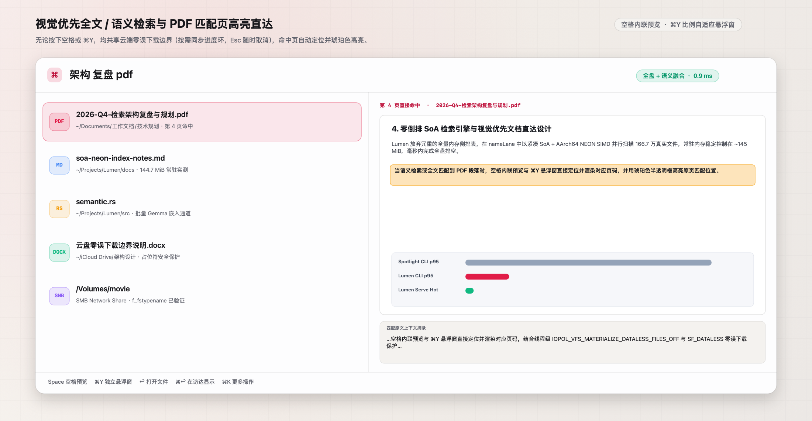
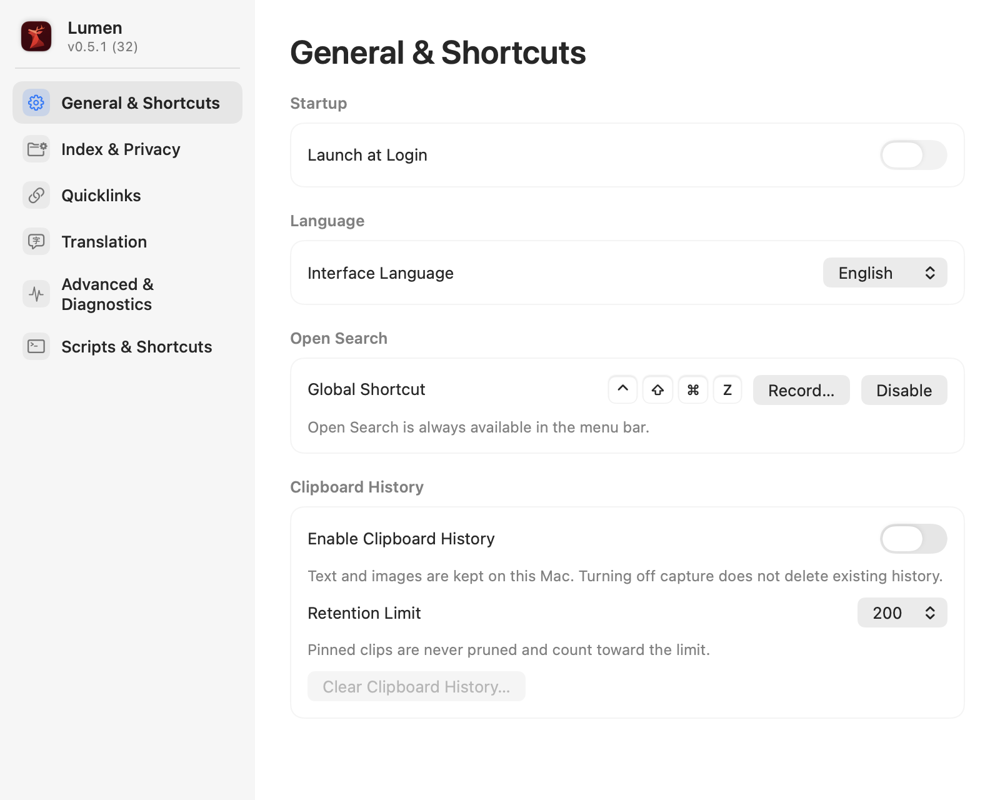

<p align="center">
  
</p>

<p align="center">
  
</p>

<h1 align="center">Lumen · 鹿鸣</h1>

<p align="center">
  <strong>一个快捷键，秒找全盘文件、打开应用、直达系统设置与文档答案。</strong><br>
  Rust 零倒排 SoA + AArch64 NEON 原生检索引擎，搭配 SwiftUI / AppKit 极简交互。<br>
  支持全盘文件名与拼音毫秒查找、PDF 匹配页视觉直达、统一多模态语义检索、SMB/NFS 网络共享发现、智能分屏，以及零误唤醒云盘保护边界。
</p>

<p align="center">
  <a href="#界面预览">界面预览</a> ·
  <a href="#为什么选择-lumen">核心能力</a> ·
  <a href="#同类工具对比">竞品对比</a> ·
  <a href="#实测性能与内存表现">性能实测</a> ·
  <a href="#快速上手与安装">快速上手</a> ·
  <a href="README.en.md">English</a>
</p>

<p align="center">
  <code>v0.5.1</code> · <code>Apple Silicon</code> · <code>macOS 14+</code> · <code>Rust + AppKit / SwiftUI</code> · <a href="LICENSE"><code>MIT License</code></a>
</p>

---

| 试着输入 | 你会看到什么 |
| :--- | :--- |
| `年报 复盘 pdf` | 同框多词匹配并按真实扩展名过滤；支持双引号精确短语搜索 |
| `luming` / `lm` | 全拼或首字母直接定位中文文件名「鹿鸣」 |
| `蓝牙` / `25 km in mi` | 无需等待文件索引，直接跳转系统设置或本地实时计算/单位换算 |
| `tr:en 会议改期了` | 同一输入框流式翻译，回车一键复制结果（支持本机 oMLX 与 OpenAI 兼容服务） |
| `qa 如何整理周报结构` | 本机提问大模型，按 `Esc` 立即取消，不联网抓取、不附带本地文件 |
| `img 帆船` | 基于本地多模态模型按画面与文档语义搜索，全过程零数据上传 |
| `?` / `win` | 浏览内置命令与辅助功能窗口管理（竖屏上/中/下分屏、一键智能平铺与批量恢复） |

---

## 界面预览

### 搜索列表与「视觉优先」文档预览（深浅色自适应）

> 选中 PDF 命中项按 **`空格`** 或 **`⌘Y`** 预览：内联窗格先展示已定位页码与半透明琥珀色高亮的页面视图，再在其下方列出原文上下文；呼出独立 Quick Look 悬浮窗则会按 PDF CropBox/旋转角或图片像素/EXIF 比例自适应缩放窗口尺寸。

<p align="center">
  <picture>
    <source media="(prefers-color-scheme: dark)" srcset="assets/readme/search-dark.png">
    <source media="(prefers-color-scheme: light)" srcset="assets/readme/search-light.png">
    
  </picture>
</p>

### 原生 macOS 设置与触感快捷键体验

> 使用原生 AppKit/SwiftUI 开关组件、实体按键帽热键录制、独立目录与排除优先级规则，以及离线模型状态灯与单文件无唤醒诊断。

<p align="center">
  <picture>
    <source media="(prefers-color-scheme: dark)" srcset="assets/readme/settings-dark.png">
    <source media="(prefers-color-scheme: light)" srcset="assets/readme/settings-light.png">
    
  </picture>
</p>

---

## 为什么选择 Lumen

- **全盘文件名约 1 ms 极速响应，百万级常驻仅 ~145 MiB**
  在单一轻量核心中采用紧凑结构体数组（SoA）与 **AArch64 NEON SIMD** 并行扫描架构，放弃冗重的内存倒排表，且文本检索通道不再重复持有名称索引。实测在 **166.7 万条真实磁盘文件** 下，全盘名称、拼音与路径热查询稳定在 **0.79–1.75 ms**，常驻内存约 **144.7 MiB**。
- **语义与全文命中直达页内，空格与 `⌘Y` 体验一致**
  对 TXT、Markdown、DOCX（正文与表格）及原生 PDF 文本层建立按需本地索引；PDF 命中结果直接跳转到对应页码并用琥珀色高亮匹配位置。浏览列表时按 **`空格`**（内联）或 **`⌘Y`**（自适应比例 Quick Look 悬浮窗）共享统一本地与云盘按需下载边界，同步展示进度环并支持 `Esc` 随时取消。
- **统一多模态语义检索、智能过滤与一键下载 Gemma**
  将文档与图片目录收口为统一的「语义与内容索引」配置：支持批量 EmbeddingGemma 推理加速、预扫目录分布、默认跳过构建产物（如 `node_modules`/`target`/`dist`/锁文件）且默认关闭源码，并提供内置 SHA-256 校验的 **HuggingFace / HF-Mirror 一键下载** 与本地离线导入。
- **物理外置盘与 SMB / NFS 网络共享 + 云盘零误下载**
  底层检索与诊断强制启用线程级 `IOPOL_VFS_MATERIALIZE_DATALESS_FILES_OFF` 与 `SF_DATALESS` 隔离（绝不误下载 iCloud/OneDrive 云端占位文件）；同时拆分物理外置盘与 SMB/NFS 网络共享状态管理（基于脱敏来源识别 NAS 挂载、绝不保存密码凭证，预览锚定内核 `f_fstypename` 白名单）。
- **原生日常效率中枢与智能分屏**
  同一个窗口整合：应用与系统设置启动、常用项目固定、数学计算与单位换算、快捷链接、带图像/文件/颜色预览的私密剪贴板历史、浅色/深色/跟随系统外观、本地脚本与 Apple 快捷指令、支持横/竖屏与智能自动平铺的窗口管理（`?` 可直接浏览），以及 `tr` / `qa` 流式翻译问答。

---

## 同类工具对比

| 维度 | **Lumen · 鹿鸣** | **macOS Spotlight** | **Raycast / Alfred** | **Oil Find** | **DigUp** |
| :--- | :--- | :--- | :--- | :--- | :--- |
| **定位** | 全盘秒搜 + 文档/语义直达 + 全能启动器 | 系统内建搜索 | 扩展生态驱动的启动器 | 高性能专用文件查找器 | 本地多模态内容检索引擎 |
| **文件名搜索引擎** | 自研 Rust 零倒排 SoA + NEON 并行扫描 | 系统 `mds` / `mdimporter` | 依赖 macOS Spotlight（`mdfind`） | 自研 C + NEON 扫描与筛选 | 侧重内容切片向量检索，非全盘文件名启动器 |
| **百万级常驻内存** | **~145 MiB**（实测 166.7 万真实文件） | 系统分布式后台常驻（不可控） | 启动器进程轻量，但依赖系统索引驻留 | 极低内存文件名常驻 | 随本地模型与向量索引规模动态变化 |
| **文档正文与本地语义** | 本地 FTS + **EmbeddingGemma** 离线检索（免费开源） | 仅关键词/元数据，无本地大模型语义召回 | 依赖 Spotlight 或插件/云端 AI | 基础版搜文件名/外置盘；文档/图像搜索需付费 Pro | 免费开源 **EmbeddingGemma 2** 多模态深搜 |
| **PDF 命中页定位与高亮** | 内联与独立预览窗 **直达命中页 + 页内高亮** | Quick Look 仅打开文件或基础查找 | 按扩展/Quick Look 方式预览 | 侧重定位文件路径与基础预览 | 展示匹配片段与定位信息 |
| **拼音 / 首字母检索** | 原生内建全拼与首字母缩写（`luming`/`lm`） | 有限支持，偶发失效 | 需额外插件或自定义脚本 | 原生支持拼音/多模式匹配 | — |
| **启动器扩展工作流** | 应用、设置、计算、剪贴板、窗口、脚本/快捷指令、`tr`/`qa` | 应用、计算与系统网页建议 | **强项**：丰富扩展生态与热键命令 | 无应用启动、剪贴板或窗口管理 | 专注文档与媒体检索，非启动器 |
| **网盘零误下载保证** | 线程级 `IOPOL` + `SF_DATALESS` 零唤醒隔离 | 视云盘 File Provider 与系统规则而定 | 依赖系统索引或插件实现 | 检查占位标识，尊重系统云文件状态 | 面向本机已选媒体目录 |
| **开源与授权** | **MIT 开源免费** | 闭源系统组件 | 核心免费（部分高级功能订阅制） | 文件名/外置盘 MIT 开源；Pro 功能闭源付费 | **开源免费** |

---

## 实测性能与内存表现

### 1. 166.7 万真实磁盘项目实测（Apple Silicon，热态 `lumen serve`）

在包含 **1,667,692 条真实本机文件/目录**、**2,370 份正文档** 与 **43,690 条 Gemma 向量** 的真实工作库上验证（单名称索引驻留 + 双通道隔离）：

| 查询场景 | 实测耗时 / 占用 | 说明 |
| :--- | ---: | :--- |
| 拼音首字母名称查询（`lm`） | **0.79 ms** | `mode=name` 热态返回 Top 60 |
| 中文双字名称查询（`临床` / `项目` / `工作` / `报告`） | **0.85–0.93 ms** | 并行 NEON 零倒排扫描 |
| 英文名称查询（`readme`） | **1.10 ms** | `mode=name` 热态 |
| 高频词 / 单字回退（`方案` / `方`） | **1.54–1.61 ms** | 166.7 万条全盘扫描无索引退化 |
| 不存在关键词名称排空（`哈基米`） | **1.75 ms** | 快速排空，不再卡顿 1–2 秒 |
| 常驻检索服务进程内存（`lumen serve` RSS） | **144.7 MiB** | 仅 `nameLane` 持有单一 `NameFast` 实例 |
| 正文全文热查询（`方案` / 不存在 FTS 词 `哈基米`） | **46.61 ms** / **0.16 ms** | `mode=text` + FTS5 前缀索引 |
| 本地 EmbeddingGemma 语义召回（14 组对照） | **~18–25 ms** | 7/7 相关查询稳定返回 11–12 条；7/7 无关词返回 **0 条噪音** |

### 2. 一百万合成文件微基准（Apple M5 Max）

在 Apple M5 Max 上首次扫描 1,000,000 个合成文件耗时 **45,503.66 ms**，预热后 `lumen serve` 内存为 **140,880 KiB（137.58 MiB）**（更新可见性检查后为 **146,960 KiB / 143.52 MiB**），4,000 次热查询均在前 20 位命中：

| 热查询类别 | p50（ms） | p95（ms） | p99（ms） |
| :--- | ---: | ---: | ---: |
| 拉丁名称 | 0.253 | 0.328 | 0.357 |
| 中文名称 | 0.495 | 1.195 | 1.368 |
| 拼音 | 0.477 | 0.961 | 1.079 |
| 多词 | 0.264 | 0.342 | 0.402 |

> 注：以上均测量核心引擎 / 常驻 CLI 的热态检索与驻留内存；图形界面整条链路延迟另受 SwiftUI 列表渲染与防抖调度影响，详细信息与十万级并发数据见 [v0.4 基线](benchmarks/v0.4-baseline.md) 与 [基准协议](docs/BENCHMARK.md)。

---

## 常用按键与命令速查

| 输入或按键 | 动作 |
| :--- | :--- |
| **`⌃⇧Space`**（可自定义） | 从任何应用上方无焦点抢占呼出 / 隐藏 Lumen |
| **`?`** | 浏览全部内置命令，方向键选择，回车填入搜索框 |
| **`tr` / `qa` / `img`** | 同输入框翻译、本机提问大模型、以文搜图 |
| **`g`** / `gh` / `wiki` / `map` | 网页快捷搜索（可在「设置 → 快捷链接」按需开启或添加） |
| **`↩` / `⌘↩` / `⌘K`** | 打开选中项、在 Finder 中显示、呼出当前项操作菜单 |
| **`空格` / `⌘Y` / `Esc`** | 浏览结果时 `空格` 快速预览，打字时正常输入；`⌘Y` 切换预览；`Esc` 优先关闭预览再收起窗口 |
| **`⇧⌘C` / `⌥⌘C`** | 复制文件名或完整路径 |
| **`⌘,`** | 打开原生设置 |

- 翻译 / 问答模型配置详见：[提供商配置](docs/TRANSLATION.md)
- 离线语义与视觉模型配置详见：[离线语义](docs/offline-gemma.md) · [模型、投影器和大小限制](docs/offline-image-search.md)

---

## 快速上手与安装

### 直接下载安装（推荐种子用户）

需要 **Apple Silicon Mac** 与 **macOS 14+**。前往 [GitHub Releases](https://github.com/Surfire/Lumen/releases/latest) 下载 **`Lumen-macos-arm64.dmg`**（或 `.zip`），可选先通过 `shasum -a 256 -c SHA256SUMS.txt` 校验摘要，随后将 `Lumen.app` 拖入 `/Applications`。

> 若使用 GitHub Actions 产出的社区无公证版本（Path B）且首次打开遇到系统拦截提示，只需在终端执行一次：
> ```sh
> xattr -dr com.apple.quarantine /Applications/Lumen.app
> ```

### 从源码构建

需要 **Apple Silicon Mac**、**macOS 14+**、Xcode 命令行工具与 Rust 工具链：

```sh
scripts/build-app.sh
open target/Lumen.app
```

上述命令生成临时签名（ad-hoc）开发版；日常本机自用推荐绑定命名本地签名身份以保留磁盘与辅助功能授权，并使用 `install-app.py` 原子替换升级：

```sh
LUMEN_SIGN_IDENTITY="Lumen Local Code Signing" scripts/build-app.sh
python3 scripts/install-app.py install target/Lumen.app
open -a "$HOME/Applications/Lumen.app"
```

### 自动检查更新与 Homebrew

- **24 小时自动检查更新与自升级**：在 **「设置 → 高级与诊断」** 与状态栏菜单中提供开关与检查入口。使用正式证书签名的版本支持校验 CMS 清单签名、ZIP SHA-256 与应用签名后一键 **「安装并重启」**（失败自动回滚备份）；无公证社区版则会弹窗跳转 Release 下载页，不绕过签名校验。
- **Homebrew & 发布流程**：模板位于 [`packaging/homebrew/Casks/lumen.rb`](packaging/homebrew/Casks/lumen.rb)（升级 `brew upgrade --cask lumen`；卸载加 `--zap` 清理配置）。发版、签名切换（Path B → Path A）详见：[发布与分发指南](docs/RELEASING.md) · [本机签名、安装和回滚](docs/UPGRADING.md)。

---

## 开发、架构与完整回归

[架构文档](docs/ARCHITECTURE.md) · [兼容范围](docs/COMPATIBILITY.md) · [发布指南](docs/RELEASING.md) · [版本变更](CHANGELOG.md) · [第三方依赖](THIRD_PARTY.md)

<details>
<summary>构建、代码检查与全套自动化验收命令</summary>

```sh
cargo fmt --check
cargo clippy --locked --all-targets -- -D warnings
cargo test --locked
scripts/build-app.sh
LUMEN_SMOKE=1 scripts/build-app.sh
python3 scripts/smoke-app.py
python3 scripts/smoke-launcher.py
python3 scripts/smoke-relaunch.py target/Lumen.app
python3 scripts/smoke-translation.py
python3 scripts/smoke-install-app.py
python3 scripts/smoke-updater.py
```

验收默认采用可复现合成资料；AppKit 焦点与 FSEvents 测试依赖 macOS 桌面会话环境。

</details>

源码采用 [MIT License](LICENSE)。产品与工程设计在独立实现中吸取并致敬了 Tinycast、Oil Find、DigUp 与 Luminator Index 的优秀理念。
