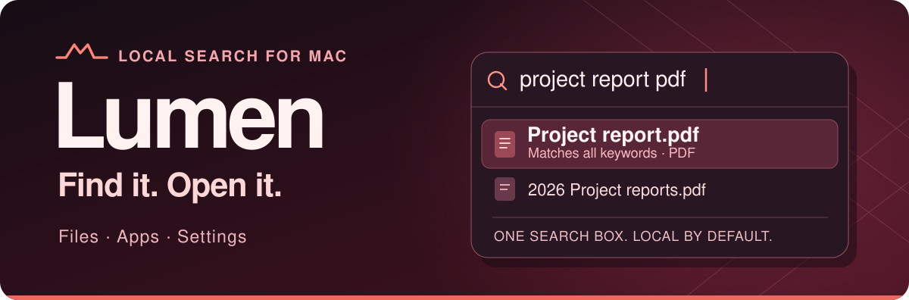

# Lumen · 鹿鸣

**一个快捷键，找到 Mac 上的文件、打开应用、直达系统设置。** 同一个输入框支持文件名、路径、拼音和已索引的正文，也可输入命令翻译、问模型或查找图片。

[快速上手](#快速上手) · [功能与边界](#功能与边界) · [开发与验证](#开发与验证) · [English](README.en.md)

**v0.3.3** · **Apple Silicon** · **macOS 14+** · **Rust + 原生 macOS 界面**

| 试着输入 | 会发生什么 |
| :--- | :--- |
| `年报 复盘 pdf` | 匹配两个关键词，按实际 PDF 扩展名过滤。可用双引号匹配连续短语。 |
| `luming` / `lm` | 用全拼或首字母查找文件名「鹿鸣」。 |
| `蓝牙` / `25 km in mi` | 直达系统设置，或在本机换算。无需先建文件索引。 |

## 快速上手

在仓库根目录构建。需要 Apple Silicon Mac、macOS 14+、Xcode 命令行工具和 Rust。

```sh
scripts/build-app.sh
open target/Lumen.app
```

这是使用临时签名（ad hoc）的开发构建。日用安装请用已有的命名签名身份，并在同一位置原位升级。首次从临时签名迁移时，macOS 可能再次询问文件访问权限。[本机签名、安装和回滚](docs/UPGRADING.md)

用菜单栏打开 Lumen，或按默认快捷键 **⌃⇧Space**。可在「设置 → 通用与快捷键」录制或停用热键。应用和系统设置可立即搜索，找文件时先从菜单栏选择「在后台建立索引」。也可先在「索引与隐私」指定范围。建立索引后，菜单栏可查看阶段、扫描数量和耗时。

重新打开 Lumen 时，符合条件的已保存索引可先用于查找。监听器在后台补查关闭期间的变动。

### 在同一个搜索框里操作

| 输入或按键 | 动作 |
| :--- | :--- |
| `?` | 查看命令，方向键选择，回车填入搜索框。 |
| `tr` | 输入 `tr:en 会议改期了`，回车提交翻译。也可输入 `tr 文本` 或「翻译」。 |
| `qa` | 输入 `qa 如何制定阅读计划？`，回车把问题发给所选模型。再次回车复制回答，Esc 可取消请求。问答不会搜索网页、附加文件或读取剪贴板。 |
| `g` | 输入 `g macOS 快捷键`，回车用默认浏览器打开 Google 搜索。可在「快捷链接」增加自定义 HTTPS 查询别名。 |
| `img` | 输入 `img 红色帆船`，按描述搜索已建立图像索引的本机图片。 |
| ↩ / ⌘↩ / ⌘K | 打开选中项、在 Finder 显示文件、打开当前结果的操作菜单。 |
| ⌘Y / Esc | 在启动器预览本地图片、PDF 或已索引原文片段。PDF 有已定位的命中页时可跳到该页。Esc 先关闭预览。 |
| ⇧⌘C / ⌥⌘C | 复制文件名或路径。 |
| ⌘, | 打开设置。 |

问答和翻译共享「设置 → 翻译」选中的提供商和模型。支持本机 oMLX 或其他 OpenAI 兼容端点。只有主动提交的文字才送达界面显示的服务。[提供商配置](docs/TRANSLATION.md)

**启用图像内容搜索。** 在「设置 → 索引与隐私 → 图像内容」选一个已纳入名称索引的本机目录和匹配的本机投影器，然后点「建立或刷新图像索引」。目前支持 PNG 和 JPEG，使用本机 EmbeddingGemma 2 模型及单独准备的视觉投影器。[模型、投影器和大小限制](docs/offline-image-search.md)

## 功能与边界

- **名称、正文与图像范围各自设置。** 名称索引默认覆盖启动盘可访问范围，跳过系统、隐私、缓存和隐藏位置。可选定目录或添加排除，排除优先。目录与正文变更在「应用」后生效。外置卷的名称索引在「索引与隐私」按需添加，断开后不显示其结果。
- **正文和语义按需启用。** 在指定目录读取本地 TXT、Markdown、DOCX 主文档的段落及表格、PDF 原生文本层。无 OCR 或 DOCX 页码。加密、超限或不支持的文档仍可按名称搜索。选配本机模型后，语义搜索可补充相关原文片段。名称搜索不需要模型。[离线语义](docs/offline-gemma.md)
- **网盘只记录可见元数据。** 已识别的 iCloud、OneDrive 和 File Provider 范围记录系统可见的名称与路径。索引和预览不会主动下载云端占位文件。搜索索引和离线推理留在本机，应用不捆绑或自动下载权重。
- **进度和缺失原因可以检查。** 「高级与诊断」分别显示文件监听和语义索引状态。使用「文件诊断 → 选取文件」检查名称、正文和语义覆盖，诊断不会读取原文或唤醒云端项目。
- **常用项目可以固定。** 空搜索可显示手动固定的项目，也可为应用、项目目录和网页创建快捷链接或别名。
- **扩展支持有限的 Raycast 接口。** 在「扩展」手动添加本地目录，可执行[明确支持的无界面命令](extensions/README.md)，包括文本提示及经确认的复制操作。Raycast Store、任意 JavaScript 和 TypeScript/React 界面不在兼容范围内。

## 开发与验证

Rust 负责扫描、索引和检索，AppKit 与 SwiftUI 提供原生界面。

[版本变更](CHANGELOG.md) · [架构](docs/ARCHITECTURE.md) · [兼容范围](docs/COMPATIBILITY.md) · [基准协议](docs/BENCHMARK.md) · [第三方依赖](THIRD_PARTY.md)

<details>
<summary>构建与回归命令</summary>

```sh
cargo fmt --check
cargo clippy --locked --all-targets -- -D warnings
cargo test --locked
cargo test --locked --manifest-path extensions/Cargo.toml
scripts/build-app.sh
python3 scripts/smoke-app.py
python3 scripts/smoke-launcher.py
python3 scripts/smoke-relaunch.py target/Lumen.app
python3 scripts/smoke-translation.py
extensions/tests/smoke-panel.sh
```

使用合成资料验证。AppKit 和 FSEvents 测试依赖 macOS 原生服务，模拟与跳过的用例不能代替实体外接盘或真实第三方服务的验收。

</details>

原创源码采用 [MIT](LICENSE)。独立实现参考了 Tinycast、Oil Find、DigUp 和 Luminator Index 的产品思路。
