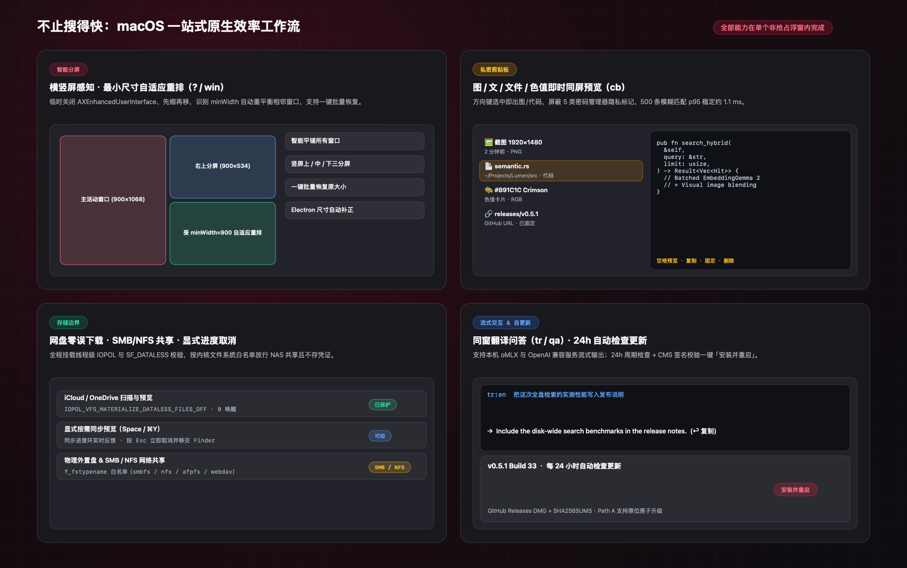
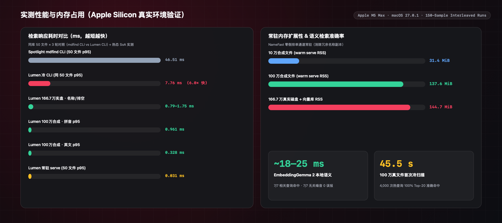

<p align="center">
  
</p>

<p align="center">
  
</p>

<h1 align="center">Lumen</h1>

<p align="center">
  <strong>一个快捷键，毫秒搜遍全盘文件、直达 PDF 匹配页高亮，并掌管 macOS 日常效率工作流。</strong><br>
  原生 Rust + AppKit/SwiftUI 构建，集百万文件瞬时检索、本地离线 AI 语义与搜图、云盘零误下载保护与自适应分屏于一体。
</p>

<p align="center">
  <a href="https://github.com/Surfire/Lumen/releases/tag/v0.6.3"></a>
  <a href="https://github.com/Surfire/Lumen/actions/workflows/ci.yml"></a>
  
  
  <a href="LICENSE"></a>
</p>

<p align="center">
  <a href="#30-秒快速上手">30 秒上手</a> ·
  <a href="#为什么选择-lumen">核心亮点</a> ·
  <a href="#界面与工作流预览">界面预览</a> ·
  <a href="#实测性能与同类对比">性能与对比</a> ·
  <a href="#快速安装与文档">快速安装</a> ·
  <a href="README.en.md">English</a>
</p>

---

## 30 秒快速上手

| 试着输入 | 立即完成什么 |
| :--- | :--- |
| `年报 复盘 pdf` | 多关键词同框秒查 + 真实扩展名过滤；支持双引号 `"精确短语"` |
| `xiangmu` / `xm` | 中文全拼或首字母直接定位「项目计划」等文件与目录；同样支持 `vsc`、`wx` 等应用缩写 |
| `猫` / `img 帆船` | 主框直接召回高相关本地图片，或用 `img` 显式跨模态搜图与文档，全程离线零上传 |
| `蓝牙` / `25 km in mi` | 无需等待索引，直接打开系统设置或实时计算数学表达式与单位换算 |
| `?` / `win` | 浏览内置指令与自适应窗口分屏（横竖屏智能布局、防重叠重排、一键批量恢复） |
| `cb` | 私密剪贴板历史，方向键选中即可预览图片、代码文件、链接与色值 |
| `tr:en 会议改期了` | 输入框内流式翻译，回车一键复制结果（支持本机 oMLX / Ollama 与 OpenAI 兼容服务） |
| `qa 如何整理周报结构` | 本地或自定义大模型即时问答，按 `Esc` 随时取消，绝不后台抓取或上传本地文件 |

---

## 为什么选择 Lumen

### 1. 全盘百万文件 ~1 ms 即输即得
- **告别 Spotlight 卡顿与漏搜**：自研原生检索引擎脱离系统后台索引限制，在 **166.7 万条真实磁盘文件** 上仅占 **~145 MiB** 内存，常规查询 **~1 ms** 即时返回，即使输入不存在的词也能在 **1.75 ms** 内立即排空，绝不卡死输入框。
- **原生中文拼音与智能缩写**：内建全拼、拼音首字母（如 `xm` 命中「项目计划」）与常用应用缩写（如 `vsc`、`ps`、`wx`、`am`），无需安装任何第三方插件。
- **越用越准的私密记忆**：本地自动记住你针对特定搜索词打开过的目标文件或应用（仅保存加密哈希，零明文记录），优先呈现正式安装的应用与活跃工作文件，自动降权历史备份与归档目录。

### 2. 视觉优先预览：PDF 原页高亮直达
- **直达命中页码 + 琥珀色原页高亮**：搜到 PDF 文档时，不再只给出一小段脱离上下文的纯文本，而是直接翻到命中页并用琥珀色高亮标记匹配段落，同时保留上下文摘录。
- **空格与 `⌘Y` 自适应悬浮预览**：浏览结果时按 **`空格`** 或 **`⌘Y`** 即可呼出 Quick Look 悬浮窗（输入打字时空格键仍正常输入），窗口按 PDF 页面裁切框、图片方向与代码比例自动贴合缩放。
- **字幕一键直达音视频**：搜到 `.srt` / `.vtt` 字幕中的台词时，可直接通过快捷操作打开同目录关联的视频或音频文件。

### 3. 本地离线 AI 检索与全格式 Office 支持
- **覆盖主流办公文档与媒体字幕**：无需安装外部工具，原生检索 PDF、现代 Office（`.docx` / `.xlsx` / `.pptx`，支持高达 256 MB 的大型演示文稿）、旧版 Office（`.doc` / `.xls` / `.ppt` / `.rtf`）、字幕（`.srt` / `.vtt`）及纯文本。
- **一键内置 Gemma 2 或连接本机 oMLX / Ollama**：可在设置页一键下载校验内置 **Gemma 2** 离线文本与多模态搜图模型（自动适配 HuggingFace 与国内 **HF-Mirror** 镜像），也可直接连接本机 `127.0.0.1` 上的 **oMLX / Ollama** 本地向量服务，文本语义与图片搜图互不干扰。
- **静音温控与智能降噪**：后台索引根据机身温度与电池状态自动调节步调，安静不烫手；添加目录时自动跳过 `node_modules`、`target`、Python 虚拟环境与本地大模型缓存等开发噪音，同时妥善保护 `Obsidian`、`Notes`、`Wiki` 等个人知识库。

### 4. 云盘零误下载保护与外置盘 / NAS 支持
- **绝不偷偷下载云端占位文件**：对 iCloud Drive、OneDrive 等云盘中的“仅在线”文件严格只读记录名称，后台扫描与索引 **绝不触发静默下载**。只有当你主动按下预览键时，才会显示可视化下载进度环，且随时可按 `Esc` 取消。
- **移动硬盘与 SMB / NFS 共享原生支持**：清晰区分物理外置移动硬盘与挂载的 NAS 网络共享（SMB / NFS / AFP / WebDAV），绝不在本地落盘保存服务器账号密码。

### 5. 开箱即用的 macOS 原生效率套件
- **横竖屏自适应分屏（`win`）**：横屏主副分栏、竖屏上中下三分屏、超宽屏多列网格一键切换；遇到有最小尺寸限制的应用窗口自动二次重排（Reflow），不重叠、不留缝，并支持一键恢复分屏前布局。
- **私密剪贴板、流式翻译与自动更新**：包含默认关闭且自动过滤密码管理器的富媒体剪贴板（`cb`）、流式翻译与问答（`tr` / `qa`）、自定义快捷链接、本地脚本 / Apple 快捷指令，以及带签名校验与回滚保护的 24 小时自动更新检查。

---

## 界面与工作流预览

### 视觉优先搜索 & PDF 匹配页高亮（深浅色自适应）

<p align="center">
  <picture>
    <source media="(prefers-color-scheme: dark)" srcset="assets/readme/search-dark.png">
    <source media="(prefers-color-scheme: light)" srcset="assets/readme/search-light.png">
    
  </picture>
</p>

### 原生设置中心与本地 AI 模型管理（深浅色自适应）

<p align="center">
  <picture>
    <source media="(prefers-color-scheme: dark)" srcset="assets/readme/settings-dark.png">
    <source media="(prefers-color-scheme: light)" srcset="assets/readme/settings-light.png">
    
  </picture>
</p>

### 智能分屏、富媒体剪贴板、云盘/NAS 安全边界与流式工作流

<p align="center">
  
</p>

---

## 实测性能与同类对比

> **实测说明**：以下数据均在 Apple Silicon 实机（Apple M5 Max · 128 GiB）上由仓库公开脚本实测，完整评测方法与分项数据见 [基准协议](docs/BENCHMARK.md)、[Spotlight 对照报告](benchmarks/v0.5.1-spotlight.md)、[百万文件基线](benchmarks/v0.4-baseline.md) 与 [版本记录](CHANGELOG.md)。

<p align="center">
  
</p>

### 1. 同机同目录对照：Lumen vs macOS Spotlight（`mdfind`）

| 检索方式（150 次随机交错查询） | p50 耗时 | p95 耗时 | p99 耗时 | 常驻内存 / 备注 |
| :--- | ---: | ---: | ---: | :--- |
| **macOS Spotlight（`mdfind` CLI）** | 42.78 ms | 46.51 ms | 50.08 ms | 系统后台索引 CLI 查询 |
| **Lumen CLI（`lumen query` 冷启动）** | **6.43 ms** | **7.76 ms** | **9.90 ms** | 每次全新启动进程，**p95 比 Spotlight 快 6 倍** |
| **Lumen 常驻服务（GUI 实际通道）** | **0.013 ms** | **0.031 ms** | **0.057 ms** | 常驻内存仅 **10.59 MiB**；新建 120 个文件 **14.5 ms** 即刻可查 |

### 2. 百万级全盘文件与本地向量检索实测摘要

| 实测场景 | 规模 | 实测表现 | 用户体感 |
| :--- | :--- | :--- | :--- |
| **真实磁盘全盘文件名检索** | **1,667,692 个文件** | 拼音首字母 **0.79 ms** · 中文双字 **0.85–0.93 ms** · 无结果排空 **1.75 ms** | 常驻内存 **144.7 MiB**，按键即出结果 |
| **标准 APFS 合成基准** | **100,000 / 1,000,000 文件** | 10 万文件 p95 **<= 0.18 ms**（**31.4 MiB**）· 100 万文件 p95 **<= 1.20 ms**（**137.6 MiB**） | 4,000 组抽样 Top-20 准确率 **100%** |
| **大规模本地语义向量评分** | **699,050 条 768 维向量** | 单次检索评分仅 **5.65 ms**（较上代提速 **38×**），向量内存减半至 **1,024 MiB** | 近 70 万文档/图片片段毫秒级语义召回 |
| **大体积 Office 提取与静音索引** | **21 MB `.pptx` / 1.67M 工作库** | 21 MB 演示文稿提取仅 **11.8 ms**（峰值内存 **10.7 MiB**）；后台模型内存降低 **>50%** | 大文档秒入库，后台索引安静不发热 |

### 3. 同类工具横向对比

| 维度 | **Lumen** | **macOS Spotlight** | **Raycast** | **Alfred** | **Oil Find** | **DigUp** |
| :--- | :--- | :--- | :--- | :--- | :--- | :--- |
| **核心定位** | 毫秒全盘秒搜 + PDF 原页直达 + 原生效率启动器 | 系统基础全局搜索 | 扩展生态驱动的工作流启动器 | 经典键盘工作流启动器 | 极低内存专用文件查找器 | 本地多模态文档与媒体深搜 |
| **全盘文件名引擎** | **自研原生内存引擎**（不依赖 Spotlight） | 系统 `mds` 后台索引 | 依赖 Spotlight | 依赖 Spotlight | 自研 C 原生极速扫描 | 侧重内容切片检索，非全盘启动器 |
| **百万文件内存** | **~138–145 MiB**（100 万–167 万文件实测） | 系统多守护进程常驻 | 界面轻量，索引由系统承担 | 界面轻量，索引由系统承担 | 极低文件名驻留内存 | 随向量库与模型规模变化 |
| **中文拼音与首字母** | **原生内建**全拼、首字母与应用缩写 | 仅极有限系统匹配 | 需安装社区扩展 | 需配置第三方工作流 | 原生内建拼音与模糊匹配 | 不以拼音文件名为核心场景 |
| **本地 AI 与文档检索** | **免费内置** PDF / 新老 Office / 字幕全文 + **Gemma 2 / 本地 oMLX & Ollama** | 仅关键词，无本地向量模型 | 官方 AI 需云端 Pro 订阅 | 需付费 Powerpack + 插件 | 文件名免费；正文/搜图需 **付费 Pro** | **免费开源**本地多模态深搜 |
| **PDF 原页高亮预览** | **直接定位命中页 + 琥珀色段落高亮** | 仅打开文件或基础预览 | 标准 Quick Look / 插件预览 | 标准 Quick Look 预览 | 侧重路径定位与常规预览 | 展示文档切片段落定位 |
| **云盘防误下载与 NAS** | **严格零误下载保护** + 外置盘与 SMB/NFS 支持 | 依赖系统云盘默认策略 | 跟随 Spotlight 与 Finder | 跟随 Spotlight 与脚本 | 识别云端占位文件防误触 | 面向用户选定的本地目录 |
| **分屏、剪贴板与工具箱** | **自适应防重叠分屏**、私密剪贴板、`tr`/`qa`、脚本 | 仅基础计算与系统建议 | **强项**：海量第三方插件商店 | **强项**：成熟 Workflows 生态 | 专注找文件，无分屏/剪贴板 | 专注内容深搜，无启动器套件 |
| **开源与费用** | **MIT 100% 免费开源** | 闭源系统组件 | 基础免费；AI 与高级功能订阅 | 基础免费；Powerpack 付费 | 文件名开源；Pro 版闭源付费 | **免费开源** |

- **什么时候选 Lumen？**：想要彻底摆脱 Spotlight 延迟和中文漏搜，在一个 **纯开源、零云端上传、轻量原生** 的应用里同时获得 **“百万文件毫秒搜索 + PDF 原页高亮 + 免费离线 AI 搜文档/搜图 + 智能分屏与剪贴板”**。
- **什么时候选 Raycast / Alfred？**：你的日常工作重度依赖 Jira、Linear、Notion、Figma 等数百个第三方 SaaS 插件生态。
- **什么时候选 Oil Find / DigUp？**：你只需要一个纯粹极简的文件名查找器（Oil Find），或专门研究文档多模态深度解析（DigUp）。

---

## 快速安装与文档

### 1. 直接下载安装（推荐）

系统要求：**Apple Silicon Mac（M1 及以上）** · **macOS 14 Sonoma 及更高版本**。

1. 前往 [GitHub Releases](https://github.com/Surfire/Lumen/releases/latest) 下载 **`Lumen-macos-arm64.dmg`**（或 `.zip`）。
2. 打开 `.dmg` 将 **`Lumen.app`** 拖入 `/Applications`（可选使用 `shasum -a 256 -c SHA256SUMS.txt` 校验完整性）。

> **首次打开提示**：社区开源构建未绑定付费 Apple 开发者公证账号，首次打开若提示“无法验证开发者”，在终端执行一次即可正常使用：
> ```sh
> xattr -dr com.apple.quarantine /Applications/Lumen.app
> ```

### 2. Homebrew Cask 安装

仓库内置 Cask 配方 [`packaging/homebrew/Casks/lumen.rb`](packaging/homebrew/Casks/lumen.rb)，支持 `brew upgrade --cask lumen` 升级（卸载时添加 `--zap` 可一并清理配置与索引）。

### 3. 从源码编译安装

```sh
# 1. 本地快速构建并运行
scripts/build-app.sh
open target/Lumen.app

# 2. 长期自用：绑定本地签名证书安装（跨版本保留辅助功能与目录权限）
LUMEN_SIGN_IDENTITY="Lumen Local Code Signing" scripts/build-app.sh
python3 scripts/install-app.py install target/Lumen.app
open -a "$HOME/Applications/Lumen.app"
```

### 4. 进阶文档与开发门禁

- **使用与配置指南**：[离线语义配置](docs/offline-gemma.md) · [多模态以文搜图](docs/offline-image-search.md) · [翻译与问答配置](docs/TRANSLATION.md) · [升级与回滚](docs/UPGRADING.md)
- **架构与工程规范**：[系统架构设计](docs/ARCHITECTURE.md) · [性能基准协议](docs/BENCHMARK.md) · [兼容性说明](docs/COMPATIBILITY.md) · [发布指南](docs/RELEASING.md) · [版本记录](CHANGELOG.md) · [第三方许可](THIRD_PARTY.md)

<details>
<summary>展开本地构建与自动化测试命令</summary>

```sh
cargo fmt --check
cargo clippy --locked --all-targets -- -D warnings
cargo test --locked
scripts/build-app.sh
LUMEN_SMOKE=1 scripts/build-app.sh
python3 scripts/smoke-app.py
python3 scripts/smoke-launcher.py
python3 scripts/smoke-relaunch.py target/Lumen.app
python3 scripts/smoke-translation.py
python3 scripts/smoke-updater.py
python3 scripts/smoke-install-app.py
```

</details>

源码基于 [MIT License](LICENSE) 开源。产品与工程实现致敬了 Tinycast、Oil Find、DigUp 与 Luminator Index 的优秀设计理念。
